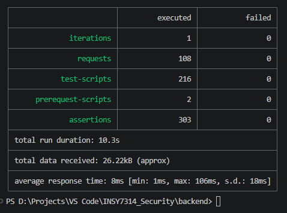
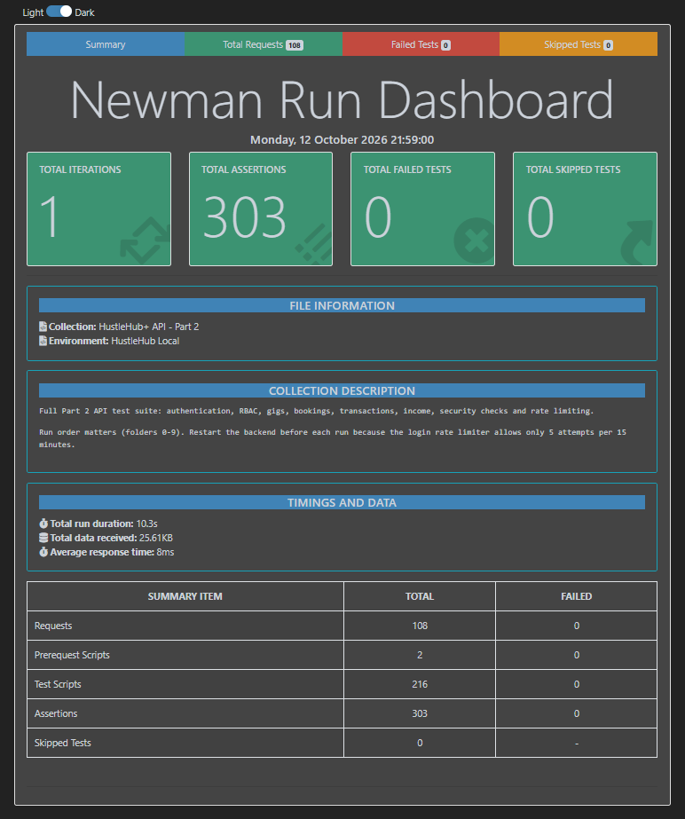
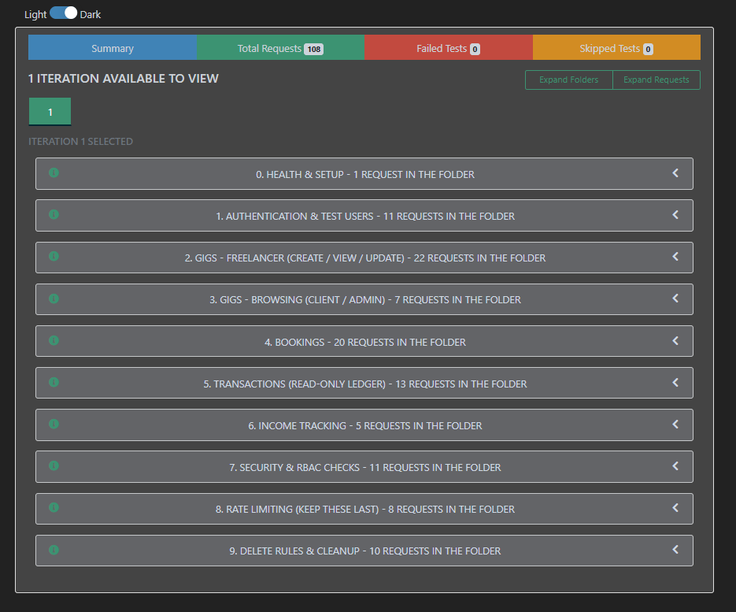
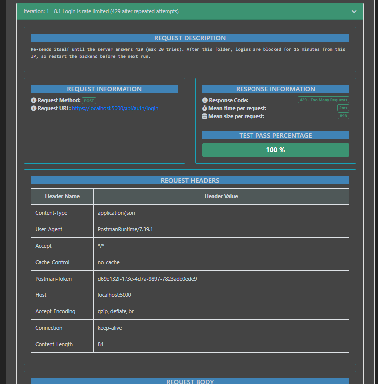

# HustleHub+ — Secure Full-Stack Freelance Marketplace

## INSY7314 / Application Development Security POE

HustleHub+ is a secure freelance marketplace application developed as part of the Application Development Security Portfolio of Evidence (POE). The platform enables freelancers to advertise their services, clients to browse and book available gigs, and users to manage marketplace activities through a secure, role-based system.

The project progresses from the secure backend foundation established in Part 1 to a full-stack MERN application in Part 2. The expanded implementation integrates a Node.js and Express REST API, a React frontend, and a MongoDB database.

Security is a core consideration throughout the application. HustleHub+ implements password hashing, JSON Web Token (JWT) authentication, role-based access control (RBAC), input validation and sanitisation, ownership checks, rate limiting, security headers, Content Security Policy (CSP), controlled error handling, and automated API testing.

Part 2 extends the system with gig management, gig browsing, booking creation, transaction recording, and freelancer income tracking. The backend is tested using Postman and Newman, while the frontend includes automated tests for component rendering and user interaction.

---

## Table of Contents

- [1. Project Overview](#1-project-overview)
- [2. Project Objectives](#2-project-objectives)
- [3. Intended Users](#3-intended-users)
- [4. Application Features](#4-application-features)
- [5. Technologies Used](#5-technologies-used)
- [6. System Architecture](#6-system-architecture)
- [7. Project Structure](#7-project-structure)
- [8. Prerequisites](#8-prerequisites)
- [9. Installation and Setup](#9-installation-and-setup)
- [10. Environment Configuration](#10-environment-configuration)
- [11. HTTPS Configuration](#11-https-configuration)
- [12. Running the Application](#12-running-the-application)
- [13. User Roles and Permissions](#13-user-roles-and-permissions)
- [14. API Endpoints](#14-api-endpoints)
- [15. Authentication and Authorisation](#15-authentication-and-authorisation)
- [16. Gig Management](#16-gig-management)
- [17. Booking and Transaction Management](#17-booking-and-transaction-management)
- [18. Freelancer Income Tracking](#18-freelancer-income-tracking)
- [19. Security Implementation](#19-security-implementation)
- [20. API Testing with Postman](#20-api-testing-with-postman)
- [21. Automated API Testing with Newman](#21-automated-api-testing-with-newman)
- [22. Frontend Testing](#22-frontend-testing)
- [23. Testing Evidence](#23-testing-evidence)
- [24. Security Decisions and Rationale](#24-security-decisions-and-rationale)
- [25. Known Limitations and Future Development](#25-known-limitations-and-future-development)
- [26. Demonstration Video](#26-demonstration-video)
- [27. Repository Information](#27-repository-information)
- [28. Conclusion](#28-conclusion)

---

# 1. Project Overview

HustleHub+ is a freelance marketplace designed to connect clients with freelancers through an online platform. Freelancers can publish and manage their service listings, while clients can browse available gigs and initiate bookings.

The application uses the MERN technology stack:

- **MongoDB** provides persistent data storage.
- **Express.js** provides the backend REST API.
- **React** provides the user interface.
- **Node.js** runs the backend application.

The project was developed incrementally across two parts of the POE.

### Part 1: Secure Backend Foundation

Part 1 established the backend authentication and security foundations, including:

- User registration and login.
- Secure password hashing using bcrypt.
- JWT generation and verification.
- Protected API routes.
- Input validation.
- HTTPS communication using a local development certificate.
- Security headers and controlled error handling.
- Initial Postman API testing.

User information was initially stored in memory to demonstrate the authentication functionality.

### Part 2: Full-Stack Marketplace

Part 2 expands the application into a full-stack marketplace by introducing:

- A React frontend.
- Persistent MongoDB storage.
- Gig creation, viewing, updating, and deletion.
- Gig browsing and filtering.
- Booking creation and confirmation.
- Automatic transaction record creation.
- Freelancer booking visibility.
- Income tracking.
- Role-based access control.
- Input sanitisation and mass-assignment protection.
- Authentication and booking rate limiting.
- Content Security Policy and additional security controls.
- Expanded Postman tests executed through Newman.
- Frontend automated testing.

Together, these components establish a more complete marketplace application in which security is applied to authentication, data access, business operations, and user interactions.

---

# 2. Project Objectives

The objectives of HustleHub+ are to:

1. Develop a full-stack MERN application with an integrated frontend, backend, and database.
2. Implement secure registration and authentication.
3. Protect sensitive endpoints using JWT authentication.
4. Enforce role-based access control for clients, freelancers, and administrators.
5. Allow freelancers to manage their own gigs.
6. Allow clients to browse available gigs and create bookings.
7. Automatically record transactions associated with bookings.
8. Track income generated by freelancers through bookings.
9. Prevent unauthorised access to resources belonging to other users.
10. Apply input validation, sanitisation, rate limiting, security headers, and CSP.
11. Provide safe and predictable error responses.
12. Test backend endpoints using Postman and Newman.
13. Include frontend automated tests for rendering and user interactions.
14. Document installation, configuration, execution, and testing procedures.
15. Demonstrate the complete marketplace workflow through a demonstration video.

---

# 3. Intended Users

HustleHub+ supports three user roles.

### Client

Clients use the platform to:

- Register and log in.
- Browse available freelance gigs.
- View gig information.
- Initiate bookings.
- Receive simulated booking confirmation.
- View their own bookings and associated transaction records, where supported by the relevant interface.

Clients cannot create, update, or delete freelancers' gig listings.

### Freelancer

Freelancers use the platform to:

- Register and log in.
- Create gig listings.
- View their own gigs.
- Update and delete their own listings.
- Browse and manage their own bookings through the relevant functionality.
- Track income generated through bookings.

A freelancer must not be able to modify or delete another freelancer's gigs or access another freelancer's private booking and income information.

### Administrator

The administrator supports administrative operations and has access to designated administrative functionality.

The administrator account is seeded through the backend's administrative setup process rather than allowing users to select the administrator role during ordinary registration.

Administrative privileges are restricted to authorised operations and are enforced through backend authorisation checks.

---

# 4. Application Features

## 4.1 User Registration and Login

Users can register and authenticate securely. Passwords are hashed before storage, and successful authentication produces a JWT for subsequent protected requests.

The registration process validates user input and prevents users from assigning themselves unauthorised privileges, including administrator access.

## 4.2 Gig Management

Freelancers can create and manage their own service listings.

The gig management functionality includes:

- Creating new gigs.
- Viewing personal gig listings.
- Viewing individual gigs.
- Updating existing gigs.
- Deleting gigs subject to ownership and authorisation rules.
- Validating gig data.
- Sanitising user-supplied content.
- Preventing unauthorised modification of protected fields.

## 4.3 Gig Browsing

Clients can browse available gigs and use the category filtering functionality.

The backend controls which gigs are returned based on availability and the authenticated user's role. Administrative access to gig listings is handled separately from ordinary client browsing.

## 4.4 Booking and Confirmation

Clients can initiate bookings for available gigs.

The booking process does not require a real payment gateway. Instead, the application simulates the confirmation process and records the booking in the database.

Each successful booking also produces an associated transaction record. Important information, including the booking price and the relevant client and freelancer, is derived or validated by the backend rather than being trusted solely from frontend input.

## 4.5 Transaction Records

Transactions provide a record of marketplace booking activity.

The transaction functionality includes:

- Creating a transaction when a booking succeeds.
- Associating the transaction with the relevant booking and users.
- Restricting transaction visibility according to authorisation rules.
- Providing read-only transaction access through the relevant API.
- Preventing unauthorised transaction creation or deletion through the transaction endpoints.

## 4.6 Freelancer Income Tracking

The application tracks income associated with a freelancer's bookings.

Income totals are calculated from the relevant booking records and are checked against the associated transactions during automated API testing.

Freelancers must not be able to retrieve another freelancer's income information. Client and administrator access to the freelancer income endpoint is restricted by the documented RBAC rules.

## 4.7 Security and Automated Testing

Security controls are integrated throughout the application rather than being limited to login.

The testing suite covers authentication, authorisation, resource ownership, validation, sanitisation, transaction integrity, rate limiting, security headers, and error handling.

The expanded API collection is executed both in Postman and through Newman from the command line.

---

# 5. Technologies Used

| Technology | Purpose |
|---|---|
| Node.js | Backend JavaScript runtime |
| Express.js | REST API framework |
| React | Frontend user interface |
| MongoDB | Persistent database storage |
| bcrypt | Secure password hashing |
| JSON Web Token (JWT) | Authentication and protected API access |
| express-validator | Request validation |
| Helmet | Security-related HTTP headers and security configuration |
| Content Security Policy (CSP) | Restricts permitted content sources |
| Rate limiting middleware | Limits repeated requests to sensitive endpoints |
| CORS | Controls cross-origin requests |
| dotenv | Environment variable management |
| selfsigned | Local development TLS certificate generation |
| Postman | Manual API testing and collection execution |
| Newman | Command-line execution of Postman collections |
| Newman HTML reporting | Human-readable API testing reports |
| Git and GitHub | Version control and project submission |
| npm | Dependency management and application scripts |

---

# 6. System Architecture

HustleHub+ uses the MERN stack, separating the frontend, backend API, and database into distinct components.

```text
                   ┌─────────────────────────┐
                   │      React Frontend     │
                   │                         │
                   │ Registration and Login  │
                   │ Gig Browsing            │
                   │ Gig Management           │
                   │ Bookings and Income      │
                   └────────────┬────────────┘
                                │
                                │ HTTPS / API Requests
                                ▼
                   ┌─────────────────────────┐
                   │     Express REST API    │
                   │        Node.js          │
                   └────────────┬────────────┘
                                │
               ┌────────────────┼────────────────┐
               │                │                │
               ▼                ▼                ▼
       ┌──────────────┐ ┌──────────────┐ ┌──────────────┐
       │ Authentication│ │  Authorisation│ │  Validation  │
       │ JWT / bcrypt  │ │   and RBAC    │ │ Sanitisation │
       └──────────────┘ └──────────────┘ └──────────────┘
                                │
                                ▼
                   ┌─────────────────────────┐
                   │    Marketplace Logic    │
                   │                         │
                   │ Gigs                    │
                   │ Bookings                │
                   │ Transactions             │
                   │ Freelancer Income        │
                   └────────────┬────────────┘
                                │
                                ▼
                   ┌─────────────────────────┐
                   │        MongoDB          │
                   │                         │
                   │ Persistent Application  │
                   │ Data                    │
                   └─────────────────────────┘

          Postman ───────────────┐
          Newman ────────────────┴──> Express REST API
```

### Request Flow

A typical authenticated marketplace request follows this process:

1. The frontend sends a request to the backend API.
2. The backend applies the relevant security middleware.
3. Request data is validated and sanitised where applicable.
4. JWT middleware verifies the user's authentication token.
5. Role-based authorisation determines whether the user may perform the operation.
6. Ownership checks confirm that the resource belongs to the authenticated user when required.
7. The relevant controller and application logic process the request.
8. The database is accessed to retrieve or modify authorised data.
9. The API returns a controlled response to the frontend.

For example, a freelancer updating a gig must be authenticated, have the freelancer role, and own the gig being updated. A valid JWT alone is not sufficient to bypass the ownership check.

---

# 7. Project Structure

The following structure identifies the important project resources documented for Part 1 and Part 2. Some internal frontend and backend source filenames may differ in the current repository.

```text
INSY7314_Security/
│
├── backend/
│   ├── src/
│   │   ├── controllers/
│   │   ├── middleware/
│   │   ├── models/
│   │   ├── routes/
│   │   ├── utils/
│   │   └── server.js
│   │
│   ├── postman/
│   │   ├── HustleHub-Part2.postman_collection.json
│   │   └── HustleHub.local.postman_environment.json
│   │
│   ├── .env
│   ├── .env.example
│   ├── generate-cert.js
│   ├── package.json
│   └── package-lock.json
│
├── docs/
│   ├── MERN/
│   │   └── MERN.jpg
│   │
│   ├── newman/
│   │   └── newman-report.html
│   │
│   └── screenshots/
│       ├── 01-register-success.png
│       ├── 02-register-duplicate-email.png
│       ├── 03-login-success.png
│       ├── 04-login-wrong-password.png
│       ├── 05-protected-route-success.png
│       ├── 06-protected-route-invalid-token.png
│       ├── 07-postman-collection-run.png
│       ├── 08-postman-login-success.png
│       ├── 09-postman-register-weak-password.png
│       ├── 10-postman-login-wrong-password.png
│       ├── 11-postman-get-profile.png
│       ├── 12-newman-run-summary.png
│       ├── 13-newman-report-summary.png
│       ├── 14-newman-report-requests.png
│       └── 15-newman-report-ratelimit-booking.png
│
├── frontend/
│   └── React application source and tests
│
└── README.md
```

**Note:** The `frontend/` directory is shown as the location of the React application. Confirm the actual directory and its source structure against the submitted repository before using this diagram as an exact file inventory.

### Separation of Concerns

The backend follows a modular structure:

- **Routes** define the API endpoints.
- **Controllers** handle incoming requests and coordinate responses.
- **Middleware** performs validation, authentication, authorisation, security checks, and error handling.
- **Models** represent application data and its interaction with persistent storage.
- **Utilities** contain reusable functionality such as password hashing and JWT generation.
- **Server configuration** initialises Express, middleware, routes, and HTTPS.
- **React frontend** provides the user interface and communicates with the API.
- **MongoDB** persists users, gigs, bookings, and transaction-related data.

This separation supports maintainability, testability, and the continued expansion of the marketplace.

---

# 8. Prerequisites

Install the following software before setting up the application:

- [Node.js](https://nodejs.org/)
- npm, included with Node.js
- [MongoDB](https://www.mongodb.com/try/download/community) or another MongoDB instance configured for the project
- [Postman](https://www.postman.com/downloads/)
- Git

Newman is also required for command-line API testing. The project dependencies and npm scripts should be installed and configured as described below.

Verify the Node.js and npm installations:

```bash
node --version
npm --version
```

Verify Git:

```bash
git --version
```

Ensure MongoDB is running and accessible using the connection settings configured for the backend.

---

# 9. Installation and Setup

## 9.1 Clone the Repository

Clone the GitHub repository:

```bash
git clone https://github.com/INSY7314-AppDev-Security/INSY7314_Security.git
```

Navigate into the project:

```bash
cd INSY7314_Security
```

If the repository uses a different default folder name on your machine, navigate into the folder created by Git.

## 9.2 Install Backend Dependencies

Navigate to the backend:

```bash
cd backend
```

Install the dependencies:

```bash
npm install
```

The backend dependencies include the packages required for Express, authentication, validation, security middleware, database access, and testing.

## 9.3 Configure Environment Variables

Create a `.env` file in the `backend/` directory, using `.env.example` as the reference.

Configure the MongoDB connection, JWT secret, server settings, and administrator credentials according to the variable names expected by the current backend implementation.

Do not copy real passwords or secret values into this README.

## 9.4 Generate the Development Certificate

From the `backend/` directory, run:

```bash
node generate-cert.js
```

This generates the local TLS certificate and private key used by the development server.

## 9.5 Seed the Administrator Account

With the backend dependencies and environment configuration in place, run:

```bash
npm run seed:admin
```

Use the configured administrator credentials when signing in or running the API test collection.

Administrator credentials must remain private and must not be committed to GitHub.

## 9.6 Install Frontend Dependencies

Open a second terminal and navigate to the actual React frontend directory.

If the directory is named `frontend`, run:

```bash
cd frontend
npm install
```

If the repository uses a different frontend directory name, use that directory instead.

---

# 10. Environment Configuration

The backend uses environment variables to keep configuration and sensitive values separate from the source code.

The following table describes the main configuration categories.

| Configuration | Purpose |
|---|---|
| Server port | Defines the backend listening port |
| JWT secret | Signs and verifies authentication tokens |
| MongoDB connection string | Connects the application to the database |
| Environment mode | Identifies the development or production environment |
| Administrator password | Configures the seeded administrator account |
| Frontend origin, if configured | Controls permitted cross-origin frontend requests |

The exact variable names must match the backend's `.env.example` and current implementation.

### Configuration Guidelines

- Create `.env` locally inside the backend directory.
- Keep `.env` out of version control.
- Use strong, unique JWT secrets.
- Use secure administrator credentials.
- Never expose credentials in frontend code.
- Never commit database passwords, private keys, or production secrets.
- Ensure the configured MongoDB instance is reachable before starting the API.
- Use a separate test database when possible to avoid mixing automated test data with demonstration data.

---

# 11. HTTPS Configuration

The backend uses HTTPS for secure communication during local development.

The development certificate is generated using:

```bash
node generate-cert.js
```

The Part 1 implementation uses a locally generated self-signed certificate. This allows encrypted local API communication during development and testing.

Because the certificate is self-signed, clients such as Postman may need certificate verification disabled for local testing. This should only be done for the intended development environment.

A self-signed certificate is not a replacement for a trusted certificate in production.

The backend should not silently fall back to unencrypted HTTP when its required TLS files are missing.

HTTPS protects data in transit, including authentication credentials and JWTs. It does not replace authentication, authorisation, validation, or secure database configuration.

---

# 12. Running the Application

The backend and frontend run as separate processes during local development.

## 12.1 Start the Backend

In the backend terminal:

```bash
cd backend
npm start
```

Ensure the following conditions are met:

- The dependencies are installed.
- The `.env` file is configured.
- MongoDB is running and reachable.
- The development certificate is available.
- The administrator has been seeded if required.

The Part 1 development server used:

```text
https://localhost:5000
```

Use the actual URL and port configured by the current backend if they differ.

The root endpoint can be checked using:

```http
GET https://localhost:5000/
```

The Part 1 root endpoint returned a response similar to:

```json
{
  "success": true,
  "message": "HustleHub+ API is running"
}
```

## 12.2 Start the React Frontend

Open a second terminal and navigate to the frontend directory.

For a frontend directory named `frontend`:

```bash
cd frontend
npm run dev
```

Open the local URL printed by the frontend development server.

The precise frontend URL depends on the configuration of the React application.

If the frontend requires an API base URL, configure it using the frontend's supported environment-variable convention. Do not expose the backend's JWT secret, administrator password, or database connection string in frontend environment variables.

## 12.3 Access the Application

Once both processes are running:

1. Open the React application in the browser.
2. Register a client or freelancer account.
3. Log in with the registered credentials.
4. Use the features available to the authenticated role.
5. Test protected operations through the interface.
6. Use Postman or Newman to verify backend responses and security behaviour independently.

---

# 13. User Roles and Permissions

Role-based access control ensures that users can perform only the actions permitted for their role.

| Functionality | Client | Freelancer | Administrator |
|---|---|---|---|
| Register and log in | Yes | Yes | Seeded account |
| Browse available gigs | Yes | Restricted | Administrative access |
| Create a gig | No | Yes | Subject to administrative rules |
| View own gigs | No | Yes | Administrative access |
| Update own gigs | No | Yes | Subject to administrative rules |
| Delete gigs | No | Own gigs, subject to rules | Subject to administrative rules |
| Create bookings | Yes | Restricted | Subject to administrative rules |
| View own bookings | Yes, where supported | Yes | Subject to administrative rules |
| View transaction records | Authorised records only | Authorised records only | Subject to administrative rules |
| View freelancer income | No | Own income | No access through the restricted income endpoint |
| Access admin-only endpoints | No | No | Yes |

The table summarises the intended permission boundaries. Actual access is determined by the backend's route middleware and authorisation logic, not by whether a frontend button is displayed.

The administrator's ability to manage gigs and the exact booking visibility rules depend on the relevant endpoint policies.

### Ownership Enforcement

Ownership checks are essential to prevent insecure direct object reference (IDOR) vulnerabilities.

For example, changing a gig ID in an API request must not allow a freelancer to update or delete another user's gig.

The backend must verify both the user's identity and the user's permission to access the requested resource.

---

# 14. API Endpoints

HustleHub+ provides REST API functionality for authentication, gig management, browsing, bookings, transactions, and income reporting.

The authentication endpoints introduced in Part 1 use the `/api/auth` base path.

| Method | Endpoint | Purpose |
|---|---|---|
| POST | `/api/auth/register` | Register a new user |
| POST | `/api/auth/login` | Authenticate a user and return a JWT |
| GET | `/api/auth/me` | Retrieve information about the authenticated user |
| Gig-related methods | Gig endpoints | Create, retrieve, update, and delete gigs according to role and ownership |
| Booking-related methods | Booking endpoints | Create bookings and retrieve authorised booking information |
| Transaction-related methods | Transaction endpoints | Retrieve authorised transaction records |
| Income-related methods | Income endpoints | Retrieve permitted freelancer income totals |
| Administrative methods | Admin-only endpoints | Perform designated administrative operations |

The exact paths and HTTP methods for the Part 2 gig, booking, transaction, income, and administrative endpoints should be taken from the current route definitions and the Postman collection. They are not specified in the supplied documentation, so they are intentionally not guessed here.

All protected endpoints require a valid JWT and must enforce the appropriate role and ownership rules.

---

# 15. Authentication and Authorisation

## 15.1 Registration

The registration process validates the submitted information before creating a user account.

The Part 1 registration requirements include:

- A required name.
- A valid email address.
- A password that meets the configured strength requirements.
- An accepted user role.
- Duplicate account prevention.

The password is hashed using bcrypt before being stored.

Ordinary users must not be able to register themselves as administrators by submitting a request containing `role: admin`.

## 15.2 Login

During login:

1. The user submits their email address and password.
2. The backend validates the request.
3. The backend finds the corresponding user.
4. bcrypt compares the submitted password with the stored hash.
5. If authentication succeeds, a JWT is generated.
6. The token is returned to the client alongside permitted user information.

Passwords and other sensitive authentication data must not be included in API responses.

## 15.3 JWT Authentication

Protected requests include the JWT in the `Authorization` header:

```http
Authorization: Bearer <JWT_TOKEN>
```

The backend verifies the token before processing the protected operation.

The Part 1 implementation uses a token containing the user's ID and role, signed using the configured JWT secret.

A missing, invalid, malformed, or tampered token must not grant access to protected endpoints.

## 15.4 Role-Based Authorisation

Authentication answers the question, "Who is making this request?"

Authorisation answers the question, "Is this user permitted to perform this action?"

For example:

- A client can initiate a booking but cannot create a freelancer listing.
- A freelancer can update their own gig but cannot update another freelancer's gig.
- An administrator can access designated administrative endpoints.
- A user cannot obtain elevated privileges by changing the role in a registration or request body.

These checks must be enforced on the backend, even when the frontend hides controls that the user is not allowed to access.

---

# 16. Gig Management

Gig management is a core marketplace feature introduced in Part 2.

## 16.1 Creating Gigs

Authenticated freelancers can create service listings.

The backend validates incoming gig data and sanitises user-supplied content where appropriate before storing it.

The backend must also prevent clients from creating gigs and prevent users from injecting unauthorised fields into the stored resource.

## 16.2 Viewing and Browsing Gigs

Freelancers can retrieve their own gig listings.

Clients can browse available gigs and filter by category. Administrative access to gig listings follows separate authorisation rules.

The backend determines which records a user may access instead of relying exclusively on frontend filtering.

## 16.3 Updating Gigs

Only an authorised owner may update their own gig, subject to the applicable administrative rules.

The backend must verify:

- The request is authenticated.
- The user's role permits the operation.
- The requested gig exists.
- The user owns the gig or has an explicitly authorised administrative permission.
- The submitted fields are permitted and valid.

## 16.4 Deleting Gigs

Deletion is restricted according to the application's ownership and administrator rules.

The backend must reject unauthorised deletion attempts and preserve data integrity where gigs are associated with bookings or transactions.

The relevant deletion rules are tested through the Postman collection.

---

# 17. Booking and Transaction Management

## 17.1 Creating a Booking

Clients can initiate a booking for an available gig.

The booking workflow is designed to:

1. Authenticate the requesting user.
2. Confirm that the user's role permits booking.
3. Validate the requested gig and booking information.
4. Verify that the gig is available for booking.
5. Retrieve the authoritative gig price and freelancer information from the backend.
6. Create the booking.
7. Create an associated transaction record.
8. Return a simulated confirmation response.

The client must not be trusted to supply authoritative prices, client identities, or freelancer identities. These values must be derived or verified by the backend.

This prevents users from manipulating booking data by modifying request payloads.

## 17.2 Simulated Confirmation

HustleHub+ does not require a real payment gateway for this assessment.

Instead, a successful booking produces a simulated confirmation and records the relevant marketplace activity.

The confirmation represents the application's booking workflow; it does not establish that a real financial payment has been processed.

## 17.3 Transaction Creation

Every successful booking must result in an associated transaction record.

The transaction records are used to maintain an auditable relationship between the booking and the users involved.

The API testing suite checks that:

- Booking creation produces a transaction.
- The relevant client and freelancer are associated correctly.
- The server-controlled booking price is used.
- Transaction visibility is restricted appropriately.
- Transactions cannot be created or deleted through the read-only transaction endpoints.

## 17.4 Viewing Bookings

Clients and freelancers must only be able to retrieve booking information permitted for their role.

Clients should not be able to retrieve other clients' private bookings, and freelancers should not be able to access unrelated freelancers' booking information.

The relevant access controls are enforced by the backend.

---

# 18. Freelancer Income Tracking

The income functionality allows freelancers to track income associated with their marketplace bookings.

Income totals are derived from the relevant booking records rather than accepting an arbitrary total supplied by the user.

The API testing suite verifies that:

- Income is associated with the correct freelancer.
- The income total corresponds to the relevant bookings.
- A freelancer cannot retrieve another freelancer's income.
- Clients cannot access the restricted freelancer income endpoint.
- Administrators are also denied access to that endpoint under the documented permission rules.

The income feature provides a basis for future financial dashboards and reporting.

Because the application uses simulated booking confirmation and does not integrate a real payment gateway, recorded booking-related income should not automatically be interpreted as verified money received.

---

# 19. Security Implementation

Security is applied throughout the frontend and backend to protect accounts, marketplace resources, and transaction-related information.

## 19.1 Password Hashing

Passwords are hashed using bcrypt instead of being stored in plain text.

The Part 1 implementation uses:

```javascript
const SALT_ROUNDS = 10;
```

The original password is not returned in registration or login responses.

## 19.2 JWT Authentication

JWTs are used to authenticate protected requests.

The backend verifies tokens using the configured signing secret. Missing, invalid, and tampered tokens are rejected.

## 19.3 Role-Based Access Control

Backend authorisation checks restrict sensitive operations according to the authenticated user's role.

Registration and request payloads cannot be used to grant administrator privileges to ordinary users.

## 19.4 Resource Ownership Checks

Gig updates, deletions, and other private resource operations are subject to ownership checks.

A valid token does not automatically grant access to every resource in the database.

## 19.5 Input Validation

Request data is validated before it is processed.

Registration and login validation introduced in Part 1 includes checks for required fields, email format, password requirements, and permitted roles.

Part 2 extends validation to marketplace operations, including gig creation, gig updates, and booking requests.

Invalid requests return controlled error responses rather than being processed as valid operations.

## 19.6 Input Sanitisation

User-supplied data is sanitised where appropriate to reduce the risk of injection and scripting attacks.

The testing suite includes XSS sanitisation and NoSQL injection scenarios.

Sanitisation complements validation and safe data handling; it does not replace database query protections or appropriate output encoding in the frontend.

## 19.7 Mass-Assignment Protection

The backend restricts which fields a user may create or modify.

Users must not be able to modify protected values, such as their role, through unauthorised request fields.

Marketplace operations also ensure that clients cannot override server-controlled booking details, including the relevant user identities and price.

## 19.8 Rate Limiting

Rate limiting is applied to sensitive endpoints to reduce abuse and repeated automated requests.

The documented configuration includes:

| Endpoint category | Limit | Window |
|---|---:|---|
| Login | 5 attempts | 15 minutes per IP |
| Booking | 10 requests | Per user, according to the configured limiter |

Requests exceeding the configured limit return HTTP `429 Too Many Requests` with a clear error message.

These limits are part of the current documented development configuration. Production deployments may require additional configuration appropriate to their infrastructure.

## 19.9 Helmet and Security Headers

Helmet is used to configure security-related HTTP headers.

These headers help protect the application against common web-based attacks and reduce exposure caused by unsafe browser behaviour.

## 19.10 Content Security Policy

A Content Security Policy restricts the sources from which the browser may load scripts and other resources.

CSP is tested through the API collection to verify that the expected security header is present.

The policy must be compatible with the application's legitimate frontend resources while avoiding unnecessarily permissive rules.

## 19.11 HTTPS

HTTPS encrypts communication between the client and the backend.

The local development environment uses a self-signed TLS certificate. Production deployments should use an appropriate trusted certificate and secure infrastructure configuration.

## 19.12 CORS

CORS controls which browser origins are permitted to communicate with the backend.

The configured policy should allow the intended frontend origin without granting unnecessary access to untrusted origins.

CORS is a browser access control mechanism, not a replacement for authentication or authorisation.

## 19.13 Controlled Error Handling

The backend uses centralised error handling to return predictable responses.

Unknown routes and unexpected server errors should not expose internal implementation details to the client.

The API testing collection includes a collection-level assertion that runs after every request and checks that responses do not leak stack traces or file paths.

## 19.14 Database Persistence

MongoDB provides persistent storage for the full-stack application.

Unlike the Part 1 in-memory user store, persistent storage allows application data to remain available across server restarts.

Database credentials must be kept in environment variables, and database access should be restricted to authorised application components.

---

# 20. API Testing with Postman

The backend API is tested using Postman to verify normal application behaviour and security enforcement.

The expanded Part 2 collection is located at:

```text
backend/postman/HustleHub-Part2.postman_collection.json
```

The associated local environment file is:

```text
backend/postman/HustleHub.local.postman_environment.json
```

The collection contains **104 requests and more than 200 assertions** covering the documented Part 2 API functionality.

## 20.1 Test Coverage

| Collection folder | Test coverage |
|---|---|
| 0. Health & Setup | API availability over HTTPS and generation of a unique run ID |
| 1. Authentication | Registration and login for two freelancers, two clients, and the seeded administrator; rejection of attempted administrator privilege escalation |
| 2. Gigs - Freelancer | Gig creation, personal listings, viewing, updating, validation errors, XSS sanitisation, mass-assignment protection, and ownership checks |
| 3. Gigs - Browsing | Client access to available gigs, category filtering, administrator browsing, and rejection of freelancer browsing where restricted |
| 4. Bookings | Booking and transaction creation, server-controlled booking information, and role-based visibility |
| 5. Transactions | Read-only ledger, per-user visibility, and prevention of transaction creation or deletion through the relevant endpoints |
| 6. Income | Income totals, booking consistency, prevention of cross-freelancer data access, and rejection of client and administrator access |
| 7. Security & RBAC | Administrator-only routes, forged or tampered JWTs, NoSQL injection, malformed JSON, Helmet headers, and CSP |
| 8. Rate Limiting | Login and booking rate limits, HTTP 429 responses, and rate-limit error messages |
| 9. Delete Rules & Cleanup | Owner and administrator deletion rules, along with data integrity after deletion |

## 20.2 Positive and Negative Testing

The collection includes successful requests and deliberately invalid or unauthorised requests.

Examples include:

- Successful user registration.
- Duplicate email registration.
- Weak passwords.
- Invalid email formats.
- Invalid roles.
- Successful login.
- Incorrect passwords.
- Missing or invalid JWTs.
- Attempts to register as an administrator.
- Attempts to modify another user's gig.
- Attempts to override protected request fields.
- Invalid or malicious request data.
- Attempts to access unauthorised transaction and income information.
- Requests exceeding rate limits.
- Requests to unknown routes.

Testing both successful and unsuccessful scenarios helps establish whether security controls are actually enforced.

---

# 21. Automated API Testing with Newman

Newman is used to execute the Postman collection from the command line. This makes API testing repeatable and produces evidence that can be included in the POE submission.

## 21.1 Relevant Files

| File | Purpose |
|---|---|
| `backend/postman/HustleHub-Part2.postman_collection.json` | Expanded API test collection |
| `backend/postman/HustleHub.local.postman_environment.json` | Local environment configuration, including host and administrator login settings |
| `docs/newman/` | Newman HTML report and related testing evidence |
| `docs/screenshots/12-newman-run-summary.png` | Newman terminal execution summary |
| `docs/screenshots/13-newman-report-summary.png` | HTML report summary |
| `docs/screenshots/14-newman-report-requests.png` | Requests grouped by collection folder |
| `docs/screenshots/15-newman-report-ratelimit-booking.png` | Booking rate-limiting evidence |

## 21.2 Prerequisites

Before running the collection:

1. Ensure MongoDB is running and accessible.
2. Configure `backend/.env` using the appropriate environment variables.
3. Install the backend dependencies.
4. Generate the local development certificate.
5. Seed the administrator account.
6. Ensure the API is available using the configured local HTTPS address.

From the backend directory, the relevant setup commands are:

```bash
npm install
node generate-cert.js
npm run seed:admin
```

The administrator seed command should be run when the test or development database needs the administrator account to be created.

## 21.3 Running the Collection in Postman

1. Start the backend:

   ```bash
   cd backend
   npm start
   ```

2. Open Postman.
3. Select **Import**.
4. Import both files:
   - `backend/postman/HustleHub-Part2.postman_collection.json`
   - `backend/postman/HustleHub.local.postman_environment.json`
5. Select the **HustleHub Local** environment.
6. Set `adminPassword` to the value configured through `ADMIN_PASSWORD` in the backend environment.
7. For local testing with a self-signed certificate, disable SSL certificate verification in Postman's settings if necessary.
8. Right-click the collection and select **Run collection**.
9. Execute the requests and review the assertion results.

SSL certificate verification should only be disabled for the intended local development setup.

## 21.4 Running Newman from the Command Line

Navigate to the backend directory:

```bash
cd backend
```

Run the API test suite:

```bash
npm run test:api
```

This executes the collection and displays the test results in the terminal.

To execute the suite and generate the HTML report:

```bash
npm run test:api:report
```

The report is written to the documented `docs/newman/newman-report.html` location, according to the project's configured script.

If the report is not generated at that location, check the output path in the relevant npm script and use the path configured in the repository.

## 21.5 Passing the Administrator Password Securely

The administrator password can be supplied to Newman without placing the actual password in the collection or environment file committed to Git:

```bash
npm run test:api -- --env-var "adminPassword=YOUR_ADMIN_PASSWORD"
```

Replace `YOUR_ADMIN_PASSWORD` with the configured local administrator password.

Do not commit real credentials to the repository or include them in testing screenshots.

## 21.6 Important Testing Considerations

**Restart the backend before every full test run.**

The rate limiters maintain counters in memory. The login limiter permits five attempts per IP within the configured 15-minute window, and the suite deliberately triggers rate-limit responses after using the permitted attempts.

Restarting the backend resets the in-memory counters in the documented local configuration.

Additional considerations:

- Each run registers users using a unique `runId`, preventing collisions caused by repeated email addresses.
- Users, bookings, and transactions remain in MongoDB after a run.
- Repeated tests may therefore add records to the database.
- Use a separate test database if demonstration data needs to remain clean.
- Ensure the API and database are in the expected state before interpreting test failures.
- Keep the administrator password out of committed files and screenshots.

## 21.7 Collection-Level Security Assertion

A collection-level test runs after every request and checks that responses do not leak stack traces or file paths.

This helps identify accidental exposure of internal implementation details in both successful and unsuccessful responses.

The assertion complements the individual endpoint tests by applying an additional security check across the collection.

---

# 22. Frontend Testing

Part 2 requires automated frontend tests to demonstrate component rendering and user interaction.

Frontend testing complements the API suite by checking the React user interface independently of the backend's endpoint-level assertions.

The frontend tests should demonstrate that:

- Relevant components render successfully.
- Interface elements are displayed as expected.
- User interactions can be performed.
- Forms respond to user input.
- Invalid inputs are handled gracefully where tested.
- The interface does not unnecessarily expose sensitive information.
- Role-specific functionality is presented appropriately.

Frontend restrictions are not a substitute for backend authorisation. Even if a button is hidden from a client, the backend must independently reject unauthorised requests.

### Running Frontend Tests

Navigate to the frontend directory and inspect its `package.json` for the configured test script.

Run the frontend test command configured by the project. For example, if the script is named `test`:

```bash
npm test
```

The command above is applicable only if the frontend's `package.json` defines that script. Use the actual script configured in the submitted application.

Capture the test results and include the relevant screenshots or other evidence in the submission.

---

# 23. Testing Evidence

Testing evidence is maintained in the repository to demonstrate that the application and its security controls have been exercised.

## 23.1 Part 1 Evidence

The original Part 1 screenshots are stored in:

```text
docs/screenshots/
```

They include evidence of:

- Successful registration.
- Duplicate registration rejection.
- Successful login.
- Incorrect password rejection.
- Protected-route access.
- Invalid-token rejection.
- Weak password rejection.
- Postman collection execution.
- Profile endpoint testing.

## 23.2 Part 2 Newman Evidence

The following screenshots document the expanded API test execution.

### Newman terminal summary



### Newman HTML report summary



### Newman requests by folder



### Newman booking rate-limiting result



The corresponding report is stored under:

```text
docs/newman/
```

## 23.3 Frontend Evidence

Include the actual frontend testing screenshots and application screenshots in the relevant repository locations.

Useful evidence includes:

- Registration and login screens.
- Gig browsing and filtering.
- Freelancer gig creation and editing.
- Booking confirmation.
- Booking and transaction records.
- Freelancer income information.
- Frontend automated test results.

Only include screenshots that exist in the repository, and ensure they do not expose passwords, tokens, or other secrets.

---

# 24. Security Decisions and Rationale

## bcrypt Password Hashing

Passwords are hashed instead of stored in plain text.

**Reason:** If stored user information is exposed, password hashing helps prevent attackers from immediately obtaining the original passwords.

## JWT Authentication

JWTs authenticate users after login.

**Reason:** Protected endpoints can verify a user's identity without requiring their password with every request.

## JWT Expiration

The Part 1 implementation uses a one-day token expiry.

**Reason:** Limiting token lifetime reduces the period during which a compromised token may be used.

## Role-Based Access Control

Backend permissions restrict operations according to the user's role.

**Reason:** Clients, freelancers, and administrators have different responsibilities. Enforcing these boundaries helps prevent unauthorised operations and privilege escalation.

## Resource Ownership Checks

The backend verifies that a user owns a resource before permitting restricted operations.

**Reason:** A user must not be able to change a resource identifier to gain access to another user's private information or modify their data.

## Input Validation and Sanitisation

Input data is checked and sanitised before processing.

**Reason:** This reduces the risk of malformed requests, injection attacks, and scripting attacks.

## Mass-Assignment Protection

The backend limits the fields that users may create or modify.

**Reason:** Clients should not be able to modify privileged fields or override important server-controlled values through manipulated request bodies.

## Rate Limiting

Sensitive endpoints enforce request limits.

**Reason:** Login and booking endpoints may be targeted by automated or abusive requests. Rate limiting helps reduce repeated attempts and excessive request activity.

## HTTPS

The application uses encrypted communication.

**Reason:** Credentials, tokens, and other sensitive data should be protected while travelling between the client and server.

## Helmet and Content Security Policy

Security headers are configured to reduce exposure to common web-based attacks.

**Reason:** Browser security policies can restrict unsafe resource loading and help mitigate certain attack techniques.

## Environment Variables

Secrets are kept outside the committed application source code.

**Reason:** Hard-coded credentials and signing secrets can be exposed to anyone who can access the repository.

## Server-Controlled Booking Values

Booking details such as price and associated users are derived or verified by the backend.

**Reason:** Trusting values supplied by the frontend would allow clients to attempt price manipulation or associate bookings with incorrect users.

## Controlled Error Responses

The backend provides safe error messages without exposing internal stack traces or file paths.

**Reason:** Internal implementation details can help attackers understand the application and identify potential weaknesses.

## Automated Security Testing

The API collection tests normal operations and deliberately invalid or unauthorised requests.

**Reason:** Security controls need to be tested to demonstrate that they are enforced, rather than merely present in the code.

---

# 25. Known Limitations and Future Development

HustleHub+ has been expanded substantially in Part 2, but some functionality remains outside the documented implementation.

### Simulated Payments

The application does not integrate a real payment gateway.

Booking confirmation and transaction recording simulate the marketplace workflow but do not verify real financial transfers.

### Local Development Certificate

The self-signed certificate is intended for local development and testing.

A production deployment requires appropriate trusted TLS certificates and secure infrastructure configuration.

### Local Testing Environment

The Newman configuration is intended for local testing and uses a local environment file.

A production environment would require separate configuration for its deployed API, database, secrets, and security controls.

### Further Development Opportunities

Potential future enhancements include:

- Real payment gateway integration.
- Enhanced booking lifecycle management.
- Freelancer and client dashboards.
- More detailed income and financial reporting.
- Notifications for bookings and status changes.
- Expanded administrative management tools.
- Improved automated frontend and integration testing.
- Continuous integration and continuous deployment (CI/CD).
- Docker containerisation.
- Centralised logging and monitoring.
- Production deployment and infrastructure hardening.
- Additional accessibility and usability improvements.

These are potential enhancements and should not be interpreted as features already implemented.

---

# 26. Demonstration Video

The demonstration video is intended to show the application working as a complete marketplace, including the main user workflows and security-related functionality.

## Part 1 Demonstration

The original Part 1 demonstration shows the backend running over HTTPS and demonstrates:

1. API startup.
2. User registration.
3. Input validation and security handling.
4. Successful login.
5. JWT generation.
6. Access to a protected endpoint.
7. Rejection of invalid or missing tokens.

**Part 1 video:** https://youtu.be/-_D20fWGG3Q

## Part 2 Demonstration

The Part 2 demonstration should show the expanded full-stack application, including:

1. User registration and login.
2. Access to the application according to user role.
3. Freelancer gig creation and management.
4. Browsing available gigs as a client.
5. Creating a booking.
6. Viewing the resulting booking.
7. Demonstrating the associated transaction record.
8. Viewing freelancer booking and income information.
9. Demonstrating relevant security and access-control behaviour.

**Part 2 video:** *Add the Part 2 demonstration video URL here once available.*

---

# 27. Repository Information

**GitHub Repository:**  
https://github.com/INSY7314-AppDev-Security/INSY7314_Security.git

The repository contains the project source code, backend implementation, frontend application, configuration examples, API test collection, Newman testing resources, and supporting documentation.

## Part 1 Submission Contents

The original Part 1 resources include:

- Backend source code.
- Authentication implementation.
- Password hashing utilities.
- JWT utilities.
- Validation middleware.
- Authentication middleware.
- Error-handling middleware.
- HTTPS certificate-generation script.
- Postman collection.
- API testing screenshots.
- MERN architecture diagram.
- Project README.

## Part 2 Submission Contents

The expanded submission includes:

- Updated backend source code.
- React frontend application.
- MongoDB integration.
- Gig management functionality.
- Gig browsing functionality.
- Booking and transaction functionality.
- Freelancer income tracking.
- JWT authentication and RBAC.
- Input validation and sanitisation.
- Rate limiting and security headers.
- Content Security Policy configuration.
- Expanded Postman collection.
- Postman local environment configuration.
- Newman execution scripts and testing evidence.
- Newman HTML report and screenshots.
- Frontend automated tests and associated evidence.
- Updated README.
- Demonstration video.

---

# 28. Conclusion

HustleHub+ has progressed from a secure backend authentication prototype in Part 1 to a full-stack freelance marketplace in Part 2.

The project integrates React, Express.js, Node.js, and MongoDB to support user authentication, gig management, gig browsing, bookings, transaction recording, and freelancer income tracking.

Security is implemented across the application's authentication, authorisation, input processing, resource ownership, and request-handling workflows. Controls include bcrypt password hashing, JWT authentication, RBAC, input validation and sanitisation, mass-assignment protection, rate limiting, Helmet security headers, Content Security Policy, HTTPS, and controlled error responses.

The expanded Postman collection and Newman execution provide repeatable backend testing across normal and adversarial scenarios. Frontend automated tests complement this by evaluating component rendering and user interaction.

Together, the implementation and testing resources demonstrate the development of a full-stack MERN application with an emphasis on secure application development, controlled access to user data, and reliable marketplace workflows.
