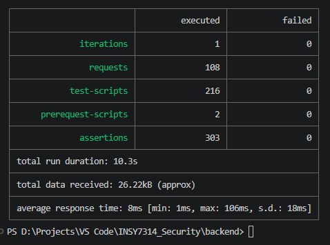
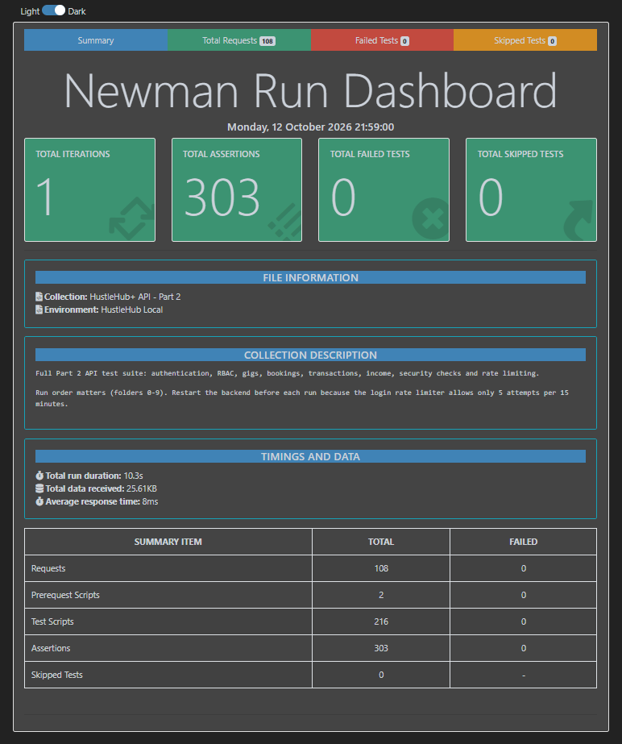
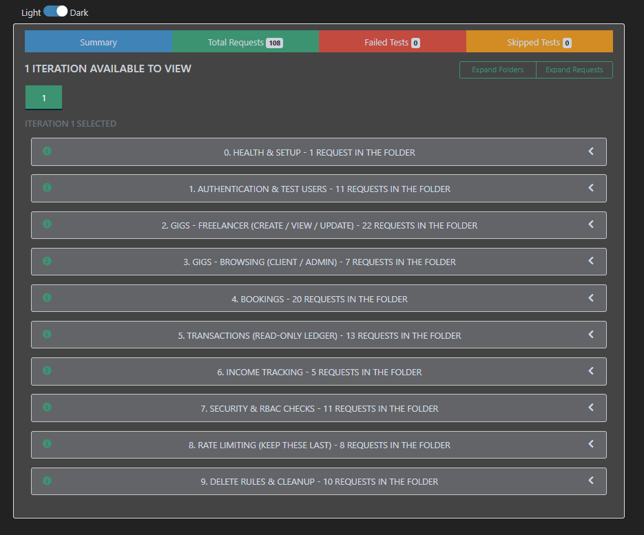
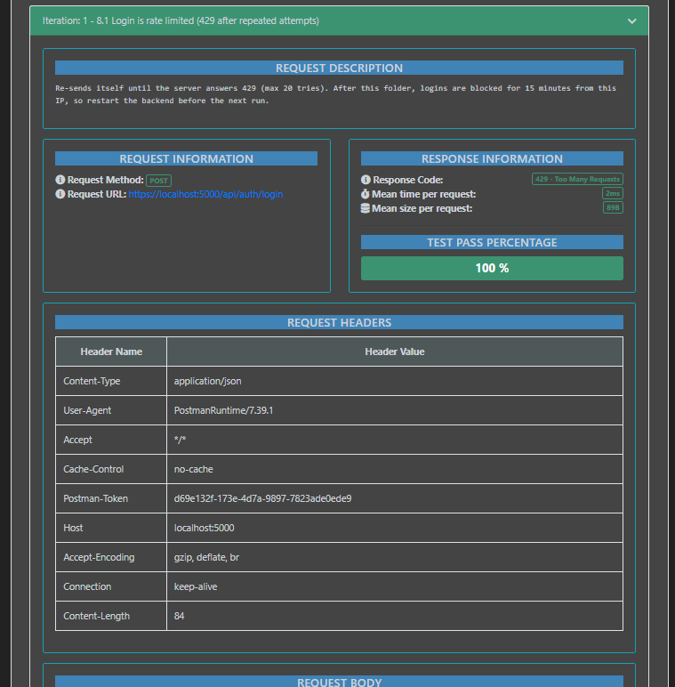

# HustleHub+ — Secure Full-Stack Freelance Marketplace

## INSY7314 | Application Development Security POE

HustleHub+ is a secure freelance marketplace developed for the Application Development Security Portfolio of Evidence (POE). The platform connects clients with freelancers, allowing freelancers to advertise their services while clients browse gigs and make bookings.

The project progresses from a secure backend prototype in Part 1 to a full-stack MERN application in Part 2, integrating a React frontend, Node.js and Express REST API, and MongoDB database.

**Security is central to the application.** Implemented controls include bcrypt password hashing, JWT authentication, role-based access control (RBAC), input validation and sanitisation, resource ownership checks, rate limiting, security headers, Content Security Policy (CSP), and controlled error handling.

Part 2 introduces gig management, booking creation, transaction recording, and freelancer income tracking. The backend is tested using Postman and Newman, while frontend testing is demonstrated in the Part 2 demonstration video.

Part 3 prepares the system for deployment. It adds an income and tax dashboard, structured security logging with cloud log monitoring, a stricter CORS rule and request size limit, and Docker containers for the backend, frontend and database, run together with Docker Compose.

---

## Table of Contents

1. [Project Overview](#1-project-overview)
2. [Features and User Roles](#2-features-and-user-roles)
3. [Technologies Used](#3-technologies-used)
4. [System Architecture](#4-system-architecture)
5. [Getting Started](#5-getting-started)
6. [Environment Configuration](#6-environment-configuration)
7. [Security Implementation](#7-security-implementation)
8. [API Testing with Postman and Newman](#8-api-testing-with-postman-and-newman)
9. [Frontend Testing](#9-frontend-testing)
10. [Part 3 – Income & Tax Dashboard and Frontend Enhancements](#10-part-3--income--tax-dashboard-and-frontend-enhancements)
11. [Part 3 – Logging and Monitoring](#11-part-3--logging-and-monitoring)
12. [Part 3 – Docker and Docker Compose](#12-part-3--docker-and-docker-compose)
13. [Testing Evidence](#13-testing-evidence)
14. [Demonstration Video](#14-demonstration-video)
15. [Limitations and Future Enhancements](#15-limitations-and-future-enhancements)
16. [Repository Information](#16-repository-information)

---

## 1. Project Overview

HustleHub+ provides an online marketplace where freelancers can advertise services and clients can discover and book available gigs.

The project was developed in three stages:

**Part 1 — Secure Backend Foundation**
- User registration and login.
- Secure password hashing using bcrypt.
- JWT generation and verification.
- Protected API endpoints.
- Input validation and error handling.
- HTTPS configuration for local development.
- Initial Postman testing.

**Part 2 — Full-Stack Marketplace**
- React frontend and MongoDB persistence.
- Gig creation, viewing, updating, and deletion.
- Gig browsing and category filtering.
- Booking creation and simulated confirmation.
- Automatic transaction record creation.
- Freelancer booking visibility and income tracking.
- Expanded security controls and role-based permissions.
- Automated API testing using Postman and Newman.
- Frontend testing demonstrated in the project video.

**Part 3: Deployment Readiness**
- Income and tax dashboard for freelancers.
- Structured security logging with Winston, optionally sent to Grafana Cloud.
- CORS restricted to the frontend origin, and a 10 kb request body limit.
- Docker containers for the backend, frontend and database, run with Docker Compose.
- A pipeline workflow that builds and runs the whole container stack.

The application combines practical marketplace functionality with security measures designed to protect user accounts, restrict access to private information, and maintain the integrity of booking-related data.

## 2. Features and User Roles

### 2.1 Application Features

| Feature | Description |
|---|---|
| Authentication | Registration, login, bcrypt password hashing, and JWT authentication. |
| Gig management | Freelancers create, view, update, and delete their own listings, subject to authorisation rules. |
| Gig browsing | Clients browse available services and filter listings by category. |
| Bookings | Clients create bookings and receive simulated confirmations. |
| Transactions | Successful bookings generate associated transaction records. |
| Income tracking | Freelancers view income totals associated with their bookings. |
| Security | Validation, sanitisation, RBAC, ownership checks, rate limiting, security headers, and controlled error responses. |
| Testing | Postman API collection, Newman execution and reporting, and frontend testing demonstrated in the video. |
| Logging and monitoring | Logins, failed logins, refused tokens, denied access, rate limit hits, bookings, transactions and errors are logged, and can be viewed in Grafana Cloud. |
| Containers | The backend, frontend and database run together in Docker containers started with one command. |

### 2.2 User Roles

**Client**
- Register and log in.
- Browse available gigs and view service information.
- Create bookings.
- Access their own booking information and permitted transaction records.

**Freelancer**
- Register and log in.
- Create and manage their own gig listings.
- View permitted booking information.
- Track income associated with their bookings.

**Administrator**
- Access designated administrative functionality.
- Perform authorised administrative operations.
- Use an account created through the backend administrator seeding process.

Role permissions are enforced by the backend. Hiding a button in the frontend does not replace server-side authorisation checks.

---

## 3. Technologies Used

| Technology | Purpose |
|---|---|
| MongoDB | Persistent database storage |
| Express.js | Backend REST API |
| React | Frontend user interface |
| Node.js | Backend JavaScript runtime |
| bcrypt | Password hashing |
| JSON Web Tokens (JWT) | Authentication |
| express-validator | Request validation |
| Helmet | HTTP security headers |
| Content Security Policy (CSP) | Restricts permitted content sources |
| Rate-limiting middleware | Limits repeated requests to sensitive endpoints |
| CORS | Only the frontend origin may call the API from a browser |
| dotenv | Environment configuration |
| Postman | API testing |
| Newman | Command-line execution of Postman collections |
| Newman HTML reporting | Readable API testing reports |
| Winston | Structured JSON logging to the console and log files |
| Grafana Cloud (Loki) | Cloud log storage, search and dashboards |
| Docker and Docker Compose | Containers for the backend, frontend and database |
| nginx | Serves the built React frontend inside its container |
| Node.js test runner | Built-in runner for the backend security and logging checks |
| Git and GitHub | Version control and collaboration |
| npm | Dependency management |

---

## 4. System Architecture

HustleHub+ uses the MERN stack, separating the user interface, API, and database.

```text
┌──────────────────────────────┐
│        React Frontend        │
│                              │
│ Authentication               │
│ Gig Browsing and Management  │
│ Bookings and Income          │
└──────────────┬───────────────┘
               │
               │ HTTPS / API Requests
               ▼
┌──────────────────────────────┐
│    Node.js / Express API     │
│                              │
│ Authentication and JWT       │
│ Role-Based Authorisation     │
│ Validation and Sanitisation  │
│ Marketplace Business Logic   │
└──────────────┬───────────────┘
               │
               ▼
┌──────────────────────────────┐
│           MongoDB            │
│                              │
│ Users, Gigs, Bookings,       │
│ and Transaction Records      │
└──────────────────────────────┘

       Postman / Newman
               │
               ▼
         Express REST API
```

The backend processes requests through the relevant security middleware, validates incoming data, verifies authentication and permissions, and performs authorised database operations.

For example, a freelancer updating a gig must be authenticated, have the appropriate role, and own the gig. A valid JWT alone does not grant unrestricted access to marketplace resources.

---

## 5. Getting Started

### 5.1 Prerequisites

Install the following:

- [Node.js](https://nodejs.org/) and npm
- [MongoDB](https://www.mongodb.com/try/download/community) or a configured MongoDB instance
- [Git](https://git-scm.com/)
- [Postman](https://www.postman.com/downloads/) for API testing
- [Docker Desktop](https://www.docker.com/products/docker-desktop/) (optional) to run the whole stack in containers

Use **Node.js 24 (npm 11)**. The frontend `package-lock.json` was created with npm 11, and `npm ci` fails on Node 22 (npm 10).

Newman must also be available through the project's configured dependencies or installation.

Verify your installations:

```bash
node --version
npm --version
git --version
```

### 5.2 Clone the Repository

```bash
git clone https://github.com/INSY7314-AppDev-Security/INSY7314_Security.git
cd INSY7314_Security
```

### 5.3 Install Backend Dependencies

```bash
cd backend
npm install
```

### 5.4 Configure the Environment

Create a local `.env` file in the `backend/` directory, using `.env.example` as a reference.

Configure the MongoDB connection, JWT secret, server settings, administrator credentials, the allowed frontend origin (`CORS_ORIGIN`), and optionally the Grafana Cloud logging values. The variables are listed in [Section 6](#6-environment-configuration).

### 5.5 Generate the Development Certificate

If required by the current backend configuration, run:

```bash
node generate-cert.js
```

This generates the local TLS certificate and private key used for development HTTPS.

### 5.6 Seed the Administrator

Run the configured administrator seeding script:

```bash
npm run seed:admin
```

Use the administrator credentials configured in the backend environment. Never commit real passwords, database credentials, JWT secrets, or private keys to GitHub.

### 5.7 Start the Backend

From the `backend/` directory:

```bash
npm start
```

The API starts over HTTPS at `https://localhost:5000`. The console shows `MongoDB connected` and then `Server is running securely on https://localhost:5000`. Logs are written to `backend/logs/`.

Your browser shows a certificate warning because the development certificate is self-signed. Open `https://localhost:5000` once and accept the warning so the frontend can reach the API.

### 5.8 Start the Frontend

Open a second terminal and navigate to the React frontend directory.

If the directory is named `frontend/`:

```bash
cd frontend
npm install
npm start
```

The site opens at `http://localhost:3000`. This is the address the API allows through CORS. The API address is set with `REACT_APP_API_URL` in `frontend/.env` (see [Section 10](#10-part-3--income--tax-dashboard-and-frontend-enhancements)).

### 5.9 Run Everything with Docker (optional)

To run the database, backend and frontend together, see [Section 12](#12-part-3--docker-and-docker-compose).

---

## 6. Environment Configuration

The application uses environment variables to separate configuration and sensitive information from source code.

| Variable | Purpose |
|---|---|
| `PORT` | Defines the API listening port |
| `JWT_SECRET` | Signs and verifies authentication tokens |
| `MONGO_URI` | Connects the backend to the database |
| `NODE_ENV` | Identifies the development or production environment |
| `ADMIN_EMAIL`, `ADMIN_PASSWORD` | Used by `npm run seed:admin` to create the administrator account |
| `CORS_ORIGIN` | The website allowed to call the API from a browser. Default `http://localhost:3000`. Use commas to allow more than one address |
| `LOG_LEVEL` | `error`, `warn`, `info` or `debug`. Default `info` |
| `GRAFANA_LOKI_URL`, `GRAFANA_LOKI_USER`, `GRAFANA_LOKI_TOKEN` | Optional. Send the logs to Grafana Cloud. Leave all three empty to log to files only |
| `REACT_APP_API_URL` | Frontend only. The address of the API, built into the React app |

Follow these security practices:

- Keep `.env` files out of version control.
- Use strong, unique secrets and passwords.
- Never expose backend secrets in frontend code.
- Keep the MongoDB instance accessible only to authorised components.
- Use a separate test database where possible.

---

## 7. Security Implementation

Security controls are applied across authentication, request processing, resource access, and marketplace operations.

| Security Control | Purpose |
|---|---|
| bcrypt password hashing | Avoids storing passwords in plain text. |
| JWT authentication | Verifies the identity of users accessing protected endpoints. |
| Role-based access control | Restricts operations according to client, freelancer, and administrator permissions. |
| Resource ownership checks | Prevents users from modifying or viewing resources belonging to other users without permission. |
| Input validation | Rejects invalid or incomplete request data. |
| Input sanitisation | Helps mitigate malicious input, including scripting and injection attempts. |
| Mass-assignment protection | Restricts which fields users may create or modify. |
| Rate limiting | Reduces repeated requests to sensitive endpoints. |
| Helmet and CSP | Configure browser-facing security headers and content-loading restrictions. |
| HTTPS | Encrypts communication in transit. |
| CORS | Only the frontend address in `CORS_ORIGIN` may call the API from a browser. Any other website gets no CORS header, so the browser blocks the response. |
| Request size limit | JSON bodies larger than 10 kb are refused with `413 Request body is too large`. |
| Security logging | Logins, failed logins, refused tokens, denied access, rate limit hits, bookings, transactions and errors are logged (see Section 11). |
| Container hardening | Containers run as non-root users, the database port is not published, and secrets come from `.env`. |
| Controlled error handling | Reduces exposure of internal stack traces and file paths. |
| Environment variables | Keep credentials and secrets separate from committed source code. |
| Server-controlled booking data | Prevents the frontend from being trusted as the authority for booking prices and user identities. |

### Important Security Decisions

**Authentication and authorisation:** Authentication identifies the user, while authorisation determines what that user may do. Both are required for protected operations.

**Ownership enforcement:** Resource identifiers supplied in requests cannot be treated as proof of ownership. The backend must verify permissions before allowing access or modification.

**Booking integrity:** Booking prices and associated user identities are derived or verified by the backend rather than trusted solely from frontend input.

**Rate limiting:** The documented local configuration includes a login limit of five attempts per IP address within 15 minutes and a booking limit of ten requests according to the configured limiter. Exceeding a limit should produce an HTTP `429 Too Many Requests` response.

**CORS:** Cross-origin rules are enforced by the browser, so they protect users and not the server. The API sends a CORS header only when the request comes from an allowed origin. Tools such as Postman, Newman and curl do not send an Origin header and are not affected. Earlier versions allowed every origin, and this was corrected so that the documentation matches the code.

**Request size limit:** `express.json({ limit: '10kb' })` is applied before any route. The largest legitimate request is a gig, which is far smaller than 10 kb, so normal use is not affected. A larger request receives a clear `413` answer and the event is logged.

**HTTPS:** The local development environment uses a self-signed certificate. Production deployment would require an appropriate trusted certificate and secure infrastructure configuration.

---

## 8. API Testing with Postman and Newman

The backend API is tested using Postman and Newman to evaluate both expected functionality and security enforcement.

### 8.1 Test Collection

The expanded Part 2 collection is located at:

`backend/postman/HustleHub-Part2.postman_collection.json`

The associated local environment file is:

`backend/postman/HustleHub.local.postman_environment.json`

The collection contains **104 requests and more than 200 assertions**, covering the documented Part 2 API functionality.

### 8.2 Test Coverage

| Test Area | Coverage |
|---|---|
| Health and setup | API availability and test-run setup |
| Authentication | Registration, login, invalid credentials, and privilege-escalation attempts |
| Gig management | CRUD operations, validation, sanitisation, and ownership enforcement |
| Gig browsing | Available gigs, category filtering, and role restrictions |
| Bookings | Booking creation, confirmation, and authorised access |
| Transactions | Record creation, visibility restrictions, and read-only access rules |
| Income | Income totals and protection against unauthorised access |
| Security and RBAC | Invalid tokens, injection scenarios, malformed requests, security headers, and CSP |
| Rate limiting | Login and booking limits, including HTTP 429 responses |
| Deletion and cleanup | Ownership rules and data integrity |

### 8.3 Positive and Negative Testing

The collection tests successful operations alongside deliberately invalid or unauthorised requests, including:

- Successful registration and login.
- Duplicate email addresses and weak passwords.
- Incorrect credentials and invalid JWTs.
- Attempts to register with administrator privileges.
- Attempts to modify another user's gig.
- Attempts to manipulate protected request fields.
- Malicious input and injection scenarios.
- Unauthorised transaction and income access.
- Requests that exceed configured rate limits.
- Unknown routes and controlled error responses.

Testing both positive and negative scenarios helps establish whether security controls are enforced rather than merely present in the code.

### 8.4 Running the Collection in Postman

1. Start the backend and ensure MongoDB is accessible.
2. Open Postman and select **Import**.
3. Import the collection and local environment JSON files.
4. Select the **HustleHub Local** environment.
5. Configure the administrator password using the local environment setting.
6. If necessary, disable SSL certificate verification only for the intended local self-signed certificate setup.
7. Run the collection and review the assertion results.

### 8.5 Running Newman

From the `backend/` directory, run:

```bash
npm run test:api
```

To execute the tests and generate the HTML report:

```bash
npm run test:api:report
```

The report location depends on the output path configured in the project's npm script. The documented location is `docs/newman/newman-report.html`.

If the test suite requires the administrator password to be supplied at execution time, use the configured script's supported environment-variable mechanism. For example:

```bash
npm run test:api -- --env-var "adminPassword=YOUR_ADMIN_PASSWORD"
```

Replace the placeholder with the local administrator password. Do not commit actual credentials or include them in screenshots.

**Testing considerations:**
- Restart the backend before a full test run when necessary, particularly because the documented rate limiters maintain in-memory counters.
- The collection uses unique run identifiers to avoid repeated registration conflicts.
- Test users, bookings, and transactions may remain in MongoDB after execution.
- Use a separate test database if demonstration data needs to remain unchanged.
- The `host` value in the environment file and collections is `https://localhost:5000`. Postman and Newman do not replace text such as `${process.env.REACT_APP_API_URL}`, so the real address must be used.

### 8.6 Part 3 Security Checks Collection (CORS and Body Limit)

A second collection checks the CORS rule and the request size limit:

`backend/postman/HustleHub-Part3-Security.postman_collection.json`

It contains **8 requests and 17 assertions**:

| Check | Expected result |
|---|---|
| Request from the allowed frontend origin | The `Access-Control-Allow-Origin` header equals that origin, and is never `*` |
| Request from an unknown website | No `Access-Control-Allow-Origin` header |
| Preflight (OPTIONS) from the allowed origin | 204, with POST and the Authorization header allowed |
| Preflight from an unknown origin | No CORS header |
| Request with no Origin header (Postman, curl) | Works normally |
| Body of about 20 kb | 413 with a safe message and no stack trace |
| Small body | Not refused for its size (validation answers with 400) |
| Broken JSON | 400 `Invalid JSON in request body` |

None of these requests use the login rate limit, so the collection can be run many times in a row. Run it from the `backend/` directory:

```bash
npm run test:api:security
```

### 8.7 Automated Backend Checks

The backend also has automated checks that use Node.js's built-in test runner, so no extra packages are needed:

```bash
npm run test:checks
```

The 17 checks confirm that:
- Allowed origins receive the CORS header and unknown origins do not, including preflight requests.
- Bodies over 10 kb are refused with 413, while normal bodies are not refused for their size.
- Broken JSON and unknown routes give controlled errors with no internal details.
- Helmet headers and the Content Security Policy are present, and protected routes refuse requests without a token.
- Log events are written as JSON lines with an `event` field, and `error.log` only holds warnings and errors.
- Emails are masked in the logs.
- With the three Grafana values set, logs are posted to `/loki/api/v1/push` with the correct login details and labels. This was checked against a local fake Loki server.

---

## 9. Frontend Testing

Frontend testing complements the backend API tests by evaluating the React interface, component rendering, and user interactions.

**Frontend testing was demonstrated in the Part 2 demonstration video.** Refer to the video for the practical demonstration of the frontend and its interactions.

The frontend testing requirement focuses on checking that relevant components render correctly and that users can interact with the interface as intended.

Frontend testing and backend security testing serve different purposes. Even if an action is hidden or unavailable in the interface, the backend must independently reject unauthorised requests.

---

## 10. Part 3 – Income & Tax Dashboard and Frontend Enhancements

**Contributor:** Justin Fussell

I was responsible for the React frontend, connecting it to the backend API, and building the Income & Tax Dashboard required for Part 3. I also completed several Part 2 fixes and usability improvements.

### What was built
- Registration and Login pages with clear guidance and success/error messages
- Browse Gigs, Create Gig, and Book a Gig pages
- Income & Tax Dashboard for freelancers
- Transactions page
- Clean navigation with role-aware buttons
- Improved UI/UX with modern cards, better spacing, loading states, empty states, and a Copy button for Gig IDs
- Booking confirmation step to prevent accidental bookings

### Tax Estimation Logic
The tax calculation uses a simplified version of South Africa’s progressive income tax rates (2026 brackets, rounded for the assignment). It is calculated on the frontend after retrieving the freelancer’s total earned amount from the backend.

| Income Range              | Tax Calculation                              |
|---------------------------|----------------------------------------------|
| R0 – R237,100             | 18%                                          |
| R237,101 – R370,500       | R42,678 + 26% of the amount over R237,100    |
| R370,501 – R512,800       | R77,362 + 31% of the amount over R370,500    |
| R512,801 – R673,000       | R121,475 + 36% of the amount over R512,800   |
| R673,001 – R857,900       | R179,147 + 39% of the amount over R673,000   |
| R857,901 – R1,817,000     | R251,258 + 41% of the amount over R857,900   |
| Above R1,817,000          | R644,489 + 45% of the amount over R1,817,000 |

The dashboard displays:
- Total Earned
- Estimated Tax
- After Tax amount

This is an estimation only and does not include actual SARS rebates or official calculations.

### Other Fixes Completed
- Moved the API URL to an environment variable (`REACT_APP_API_URL`) so it is not hard-coded
- Added a Content Security Policy (CSP) meta tag in `index.html`
- Fixed the frontend so freelancers can also browse all gigs
- Regenerated `package-lock.json` so `npm ci` works cleanly
- Replaced placeholder frontend tests with real tests that pass
- Improved form feedback, toasts, and overall usability

### Environment Variable
Create a file called `.env` in the `frontend` folder with:

```text
REACT_APP_API_URL=https://localhost:5000
```


## 11. Part 3 – Logging and Monitoring

**Contributor:** Thomas Pheiffer

The backend uses **Winston** to record the key events of the system. Every event is written as one JSON line with a time, an event name (the `event` field) and details. Each line goes to three places:

1. The console.
2. `backend/logs/combined.log` for all events. A new file starts at 5 MB.
3. `backend/logs/error.log` for warnings and errors only.

When `GRAFANA_LOKI_URL`, `GRAFANA_LOKI_USER` and `GRAFANA_LOKI_TOKEN` are set in `.env`, the same lines are also sent to **Grafana Cloud (Loki)** in batches every 5 seconds. Without these values the application still works and logs to files only.

### 11.1 What Is Logged

| Event | Level | Details | Why it matters |
|---|---|---|---|
| `REGISTER_SUCCESS` | info | user id, role, IP | Shows account creation |
| `REGISTER_DUPLICATE_EMAIL` | warn | masked email, IP | Shows attempts to reuse an email address |
| `LOGIN_SUCCESS` | info | user id, role, IP | Audit trail of who logged in and when |
| `LOGIN_FAILED` | warn | reason (`unknown_email` or `wrong_password`), IP | Many failures from one place can mean password guessing |
| `AUTH_FAILED` | warn | reason (`no_token` or `invalid_token`), IP, path | Shows token tampering and expired sessions |
| `ACCESS_DENIED` | warn | user id, role, method, path | A logged-in user tried an action their role does not allow |
| `RATE_LIMIT_HIT` | warn | limiter (`login` or `booking`), IP, path | Shows automated abuse |
| `BOOKING_CREATED` | info | booking, gig, client, freelancer, amount | Audit trail for every booking |
| `TRANSACTION_CREATED` | info | transaction, reference, booking, amount, currency | Proves that a money record was created for each booking |
| `TRANSACTION_FAILED` | error | booking, error | A booking was rolled back |
| `REQUEST_ERROR` | warn | status, method, path, error | Bad requests such as broken JSON or a body over 10 kb |
| `SERVER_ERROR` | error | status, method, path, error, stack trace | Real faults. The stack trace stays in the log and is never sent to the client |
| `SERVER_STARTED`, `DB_CONNECTED`, `DB_CONNECTION_FAILED`, `STARTUP_FAILED` | info, error | port, reason | Health of the system |

### 11.2 Why Logging Matters

- **Detecting attacks:** repeated `LOGIN_FAILED`, `RATE_LIMIT_HIT`, `AUTH_FAILED` and `ACCESS_DENIED` events show brute force attempts, token tampering and users trying to go beyond their role.
- **Investigating incidents:** each line shows who did what, from which IP address, and when.
- **Financial records:** `BOOKING_CREATED` and `TRANSACTION_CREATED` prove that each booking created a transaction.
- **Finding faults:** `SERVER_ERROR` lines hold the full detail, so problems can be fixed without showing details to users.

This addresses the OWASP Top 10 category of security logging and monitoring failures.

### 11.3 Privacy

Passwords and tokens are never logged. Emails are masked (`j***@example.com`). Stack traces only appear in the server logs and are never returned to the client.

Example line:

```json
{"event":"LOGIN_FAILED","level":"warn","reason":"wrong_password","userId":"...","ip":"::1","service":"hustlehub-api","timestamp":"..."}
```

### 11.4 Cloud Logging with Grafana Cloud

1. Create a free Grafana Cloud account and stack.
2. In **Connections, Data sources**, open the Loki data source and copy its URL and user number.
3. Create an access policy with the **logs: write** scope and generate a token.
4. Put the three values in `.env`. They are never committed.
5. In **Explore**, run `{app="hustlehub"}`.

The dashboard uses these LogQL queries:

| Panel | Query |
|---|---|
| Events over time | `sum by (event) (count_over_time({app="hustlehub"} \| json [5m]))` |
| Failed logins | `sum(count_over_time({app="hustlehub"} \| json \| event="LOGIN_FAILED" [1h]))` |
| Bookings and transactions | `sum(count_over_time({app="hustlehub"} \| json \| event=~"BOOKING_CREATED\|TRANSACTION_CREATED" [1h]))` |
| Rate limit hits | `sum(count_over_time({app="hustlehub"} \| json \| event="RATE_LIMIT_HIT" [1h]))` |
| Errors | `{app="hustlehub", level="error"}` |
| Denied access and bad tokens | `{app="hustlehub"} \| json \| event=~"ACCESS_DENIED\|AUTH_FAILED"` |

Only two labels (`app` and `env`) are used, plus the log level. The event name stays inside the JSON line, which follows the Loki recommendation to keep labels few.

### 11.5 How the Logging Was Tested

`npm run test:checks` starts the logger in a separate process and confirms that events become JSON lines with an `event` field, that `error.log` only holds warnings and errors, that emails are masked, and that with the three Grafana values set the logs are posted to `/loki/api/v1/push` with the right login details and labels (checked against a local fake Loki server). See [Section 8.7](#87-automated-backend-checks).

### 11.6 Part 2 Fixes: CORS and Request Size Limit

- **CORS:** the API previously allowed every origin, while this README described it as restricted. The code now allows only the origins in `CORS_ORIGIN` (default `http://localhost:3000`), and the documentation matches the code. The rule is tested in [Section 8.6](#86-part-3-security-checks-collection-cors-and-body-limit).
- **Request size limit:** JSON bodies over 10 kb are refused with `413`.
- **Postman base URL:** the Postman environment and collections held the text `${process.env.REACT_APP_API_URL}`, which Postman and Newman never replace. It is now `https://localhost:5000`, so the collections can reach the API.

---

## 12. Part 3 – Docker and Docker Compose

**Contributor:** Thomas Pheiffer

The whole system runs in containers, started together with Docker Compose.

```text
 Browser
   │
   ├── http://localhost:3000 ──► frontend container (nginx, port 8080)
   │
   └── https://localhost:5000 ─► backend container (Node.js, HTTPS)
                                        │
                                        ▼
                                  mongo container (database, not published)
```

| Service | Image | Port | Notes |
|---|---|---|---|
| `mongo` | `mongo:7` | none (internal only) | Data is kept in a Docker volume. The database cannot be reached from outside Docker |
| `backend` | `backend/Dockerfile` (Node 24) | 5000 (HTTPS) | Runs as a non-root user. Installs production packages only. Makes its own self-signed certificate on start. Has an HTTPS health check. Logs go to a volume |
| `frontend` | `frontend/Dockerfile` (build, then nginx) | 3000 | Multi-stage build. Unprivileged nginx on port 8080. Sends a Content Security Policy and other security headers |

### 12.1 Run the Whole Stack

```bash
cp .env.example .env          # then set JWT_SECRET and ADMIN_PASSWORD
docker compose up --build
docker compose exec backend npm run seed:admin
```

On Windows Command Prompt, use `copy .env.example .env` instead of `cp`.

Open `http://localhost:3000` for the site. Open `https://localhost:5000` once and accept the certificate warning, so the browser allows calls to the API.

Useful commands:

| Command | Purpose |
|---|---|
| `docker compose ps` | Shows whether each service is healthy |
| `docker compose logs backend` | Shows the backend logs |
| `docker compose down` | Stops everything |
| `docker compose down -v` | Stops everything and deletes the database |

### 12.2 Design and Security Choices

- Containers do not run as root.
- The backend image contains only the packages it needs (`npm ci --omit=dev`). Test tools are not included.
- Secrets come from `.env`, which is never committed. Compose refuses to start if `JWT_SECRET` or `ADMIN_PASSWORD` is missing.
- The database port is not published.
- `.dockerignore` files keep `.env`, certificates, logs and tests out of the images.
- The frontend image uses Node 24 because the frontend `package-lock.json` was made with npm 11, and `npm ci` on npm 10 (Node 22) cannot install it.
- nginx hides its version and sets `Content-Security-Policy`, `X-Content-Type-Options`, `X-Frame-Options`, `Referrer-Policy` and `Permissions-Policy`.
- Both containers have health checks, and Compose starts the backend only after the database is healthy.

### 12.3 Containers in the Pipeline

The workflow `.github/workflows/docker.yml` runs on every push to `main` and every pull request. It builds both images, starts the stack with `docker compose up --wait`, creates the admin user, and then tests that:

1. The API answers over HTTPS.
2. Admin login returns a token, and the admin-only route accepts it.
3. CORS allows the frontend origin and refuses an unknown origin.
4. The frontend page loads and sends a Content Security Policy.
5. The login appears in the backend logs.

If any step fails, the run fails. The values used in the workflow only exist for that run. Real secrets belong in the repository secrets.

### 12.4 Troubleshooting

| Problem | Fix |
|---|---|
| `JWT_SECRET` or `ADMIN_PASSWORD` error on start | Create the root `.env` from `.env.example` |
| Port 3000 or 5000 already in use | Stop any local `npm start` windows |
| Backend not healthy | Run `docker compose logs backend` |
| Frontend cannot log in | Open `https://localhost:5000` once and accept the certificate |

---

## 13. Testing Evidence

The repository includes supporting evidence for the application's authentication and security testing.

### 13.1 Part 1 Evidence

The original screenshots are stored in `docs/screenshots/` and include evidence of:

- Successful registration and login.
- Duplicate registration and incorrect password rejection.
- Protected endpoint access and invalid-token rejection.
- Weak password validation.
- Postman collection execution.

### 13.2 Part 2 Newman Evidence

The following images document the expanded API testing process.

**Newman terminal summary**



**Newman HTML report summary**



**Requests grouped by collection folder**



**Booking rate-limiting evidence**



The corresponding report is stored under `docs/newman/`, according to the configured report output path.

The demonstration video provides additional evidence of the full-stack application and frontend testing.

### 13.3 Part 3 Evidence

**Logging: Grafana Cloud**


**Logging: log file**


**Docker**


**CORS and request size limit**


---

## 14. Demonstration Video

The demonstration video provides a practical walkthrough of HustleHub+, including the full-stack application and frontend testing.

### Part 2 — Full-Stack Application and Frontend Testing

**[Watch the HustleHub+ Part 2 Demonstration on YouTube](https://youtu.be/AIqp65AaJ7w)**

The video serves as the primary demonstration of the expanded application and its frontend functionality.

### Part 3: Deployment Readiness

*The link to the Part 3 demonstration will be added here when the video is uploaded.* It shows the containers running with Docker Compose, the pipeline, the logging in Grafana Cloud, and the CORS and request size rules.

### Part 1 — Secure Backend Foundation

**[Watch the Part 1 Backend Demonstration](https://youtu.be/-_D20fWGG3Q)**

The original demonstration covers the backend authentication foundation, including HTTPS, registration, login, JWT generation, protected endpoints, and rejection of invalid or missing tokens.

---

## 15. Limitations and Future Enhancements

Although HustleHub+ supports the core freelance marketplace workflow, several enhancements could be introduced in future development.

**Simulated payments:** Booking confirmations and transaction records simulate marketplace activity; the application does not integrate a real payment gateway.

**Development HTTPS:** The self-signed certificate is intended for local development, not production deployment.

**CORS:** CORS is a browser rule. It protects users and does not replace authentication on the server.

**Docker database:** Inside Docker Compose the MongoDB container has no password. It can only be reached from the other containers, because its port is not published.

**API address:** The API address is built into the frontend when it is built (`REACT_APP_API_URL`), so changing it needs a rebuild.

**Log storage:** Logs are kept on the server in `backend/logs/` (rotated at 5 MB) and, when configured, in Grafana Cloud. The rate limit counters are kept in memory, so they reset when the server restarts.

**Future enhancements:**
- Real payment gateway integration.
- Notifications for bookings and status changes.
- Expanded client, freelancer, and administrator dashboards.
- More detailed financial reporting.
- Additional frontend and integration tests.
- Continuous integration and continuous deployment (CI/CD).
- Production deployment, alerting on log events, and infrastructure hardening (a database password and trusted certificates).
- Further accessibility and usability improvements.

These are potential improvements rather than claims about existing functionality.

---

## 16. Repository Information

**GitHub Repository:** [INSY7314_Security](https://github.com/INSY7314-AppDev-Security/INSY7314_Security)

The repository contains the project source code, frontend and backend applications, configuration examples, Postman collection, Newman testing resources, screenshots, and supporting documentation.

### Part 1 Deliverables
- Secure backend authentication foundation.
- Password hashing and JWT utilities.
- Validation, authentication, and error-handling middleware.
- HTTPS certificate-generation script.
- Initial Postman collection and testing evidence.
- Project documentation.

### Part 2 Deliverables
- React frontend and Express backend.
- MongoDB integration.
- Gig management and browsing.
- Booking and transaction functionality.
- Freelancer income tracking.
- Authentication, RBAC, and additional security controls.
- Expanded Postman collection and Newman execution.
- Newman HTML report and testing screenshots.
- Frontend testing demonstrated in the video.
- Updated project documentation and demonstration video.

### Part 3 Deliverables (Logging, CORS and Containers)
- Winston logging of logins, bookings, transactions, errors and security events.
- Optional cloud logging to Grafana Cloud.
- CORS restricted to the frontend origin, and a 10 kb request body limit.
- Backend and frontend Dockerfiles and a Docker Compose file.
- A pipeline workflow that builds and runs the container stack (`.github/workflows/docker.yml`).
- A Postman collection and automated checks for CORS, the request size limit and logging.
- Updated project documentation.

---

## Conclusion

HustleHub+ demonstrates the development of a full-stack MERN freelance marketplace with an emphasis on secure application development. The application integrates authentication, role-based permissions, gig management, bookings, transaction recording, and freelancer income tracking.

Security controls are supported by a structured API testing suite executed through Postman and Newman, while frontend testing is demonstrated in the Part 2 video. Part 3 adds security logging with cloud monitoring and a containerised setup, so the whole system can be started with one command and its security-relevant events can be traced. Together, the application, testing resources, and demonstration provide evidence of the project's functionality and its approach to protecting users and marketplace data.