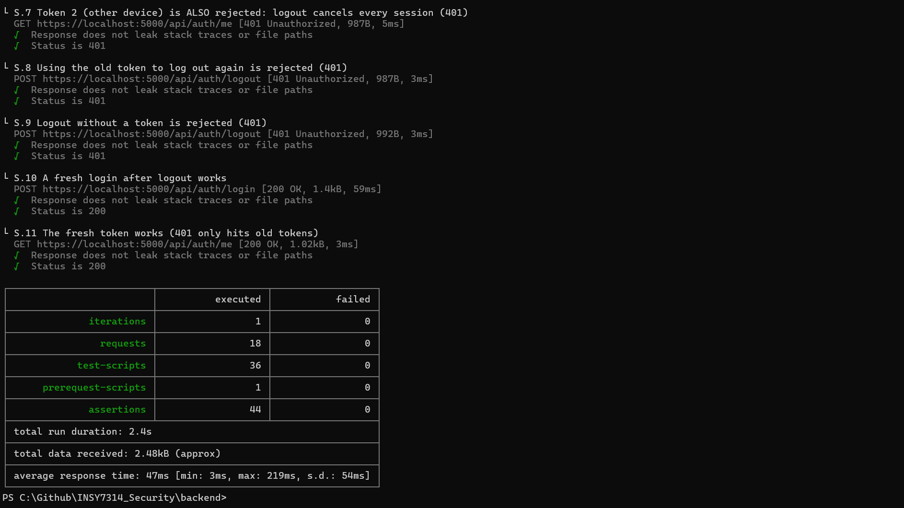
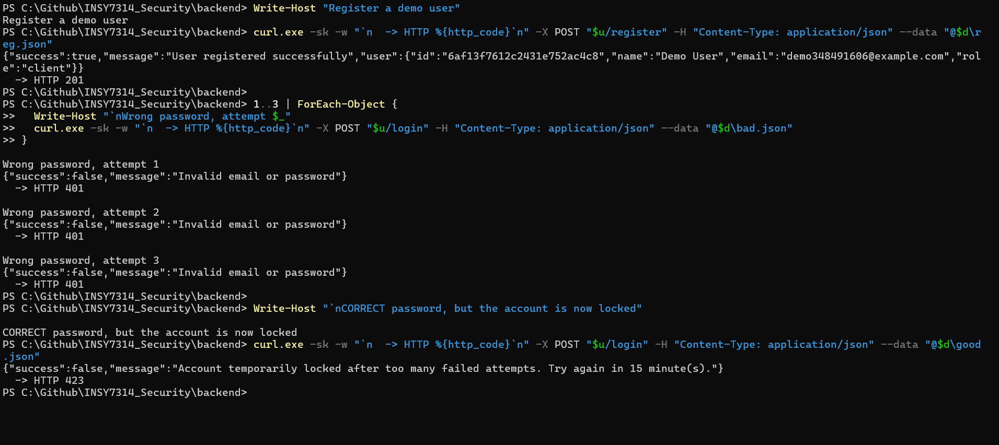
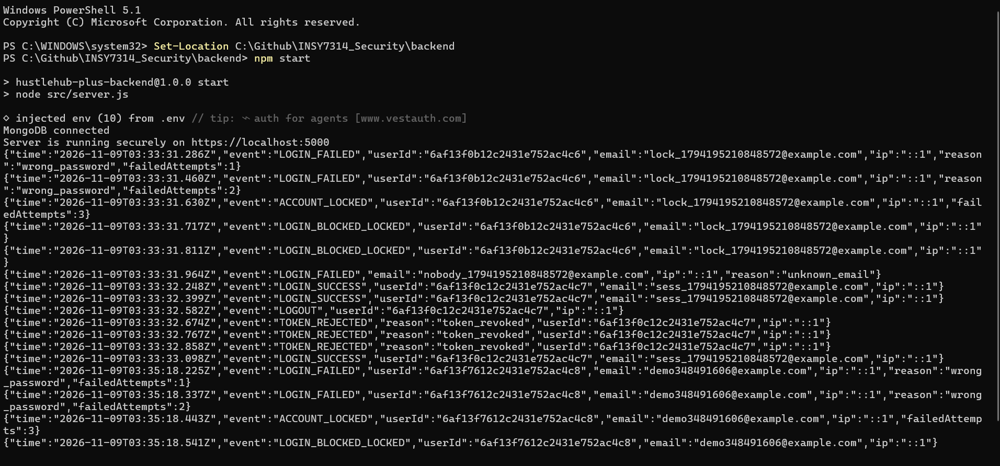
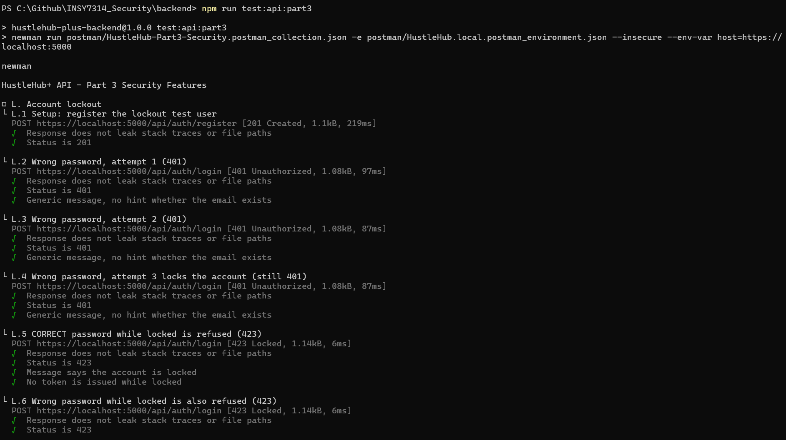
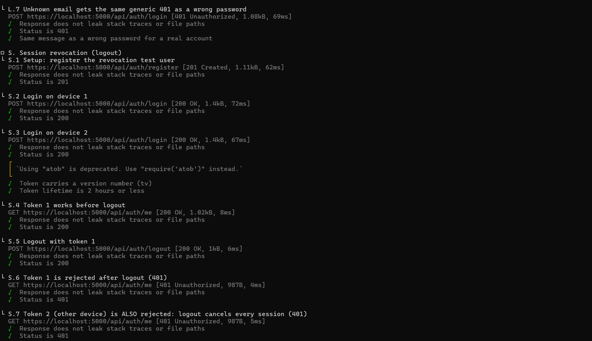

# HustleHub+ — Secure Full-Stack Freelance Marketplace

## INSY7314 | Application Development Security POE

HustleHub+ is a secure freelance marketplace developed for the Application Development Security Portfolio of Evidence (POE). The platform connects clients with freelancers, allowing freelancers to advertise their services while clients browse gigs and make bookings.

The project progresses from a secure backend prototype in Part 1 to a full-stack MERN application in Part 2, integrating a React frontend, Node.js and Express REST API, and MongoDB database.

**Security is central to the application.** Implemented controls include bcrypt password hashing, JWT authentication, role-based access control (RBAC), input validation and sanitisation, resource ownership checks, rate limiting, security headers, Content Security Policy (CSP), and controlled error handling.

Part 2 introduces gig management, booking creation, transaction recording, and freelancer income tracking. The backend is tested using Postman and Newman, while frontend testing is demonstrated in the Part 2 demonstration video.

---

## Table of Contents

1. [Project Overview](#1-project-overview)
2. [Features and User Roles](#2-features-and-user-roles)
3. [Technologies Used](#3-technologies-used)
4. [System Architecture](#4-system-architecture)
5. [Getting Started](#5-getting-started)
6. [Environment Configuration](#6-environment-configuration)
7. [Security Implementation](#7-security-implementation)
8. [API Testing with Postman and Newman](#8-api-testing-with-postman-and-newman)
9. [Frontend Testing](#9-frontend-testing)
10. [Part 3 – Income & Tax Dashboard and Frontend Enhancements](#10-part-3--income--tax-dashboard-and-frontend-enhancements)
11. [Part 3 – Additional Security Features](##-Additional-Security-Features (Part 3))
12. [Testing Evidence](#11-testing-evidence)
13. [Demonstration Video](#12-demonstration-video)
14. [Limitations and Future Enhancements](#13-limitations-and-future-enhancements)
15. [Repository Information](#14-repository-information)

---

## 1. Project Overview

HustleHub+ provides an online marketplace where freelancers can advertise services and clients can discover and book available gigs.

The project was developed in two stages:

**Part 1 — Secure Backend Foundation**
- User registration and login.
- Secure password hashing using bcrypt.
- JWT generation and verification.
- Protected API endpoints.
- Input validation and error handling.
- HTTPS configuration for local development.
- Initial Postman testing.

**Part 2 — Full-Stack Marketplace**
- React frontend and MongoDB persistence.
- Gig creation, viewing, updating, and deletion.
- Gig browsing and category filtering.
- Booking creation and simulated confirmation.
- Automatic transaction record creation.
- Freelancer booking visibility and income tracking.
- Expanded security controls and role-based permissions.
- Automated API testing using Postman and Newman.
- Frontend testing demonstrated in the project video.

The application combines practical marketplace functionality with security measures designed to protect user accounts, restrict access to private information, and maintain the integrity of booking-related data.

## 2. Features and User Roles

### 2.1 Application Features

| Feature | Description |
|---|---|
| Authentication | Registration, login, bcrypt password hashing, and JWT authentication. |
| Gig management | Freelancers create, view, update, and delete their own listings, subject to authorisation rules. |
| Gig browsing | Clients browse available services and filter listings by category. |
| Bookings | Clients create bookings and receive simulated confirmations. |
| Transactions | Successful bookings generate associated transaction records. |
| Income tracking | Freelancers view income totals associated with their bookings. |
| Security | Validation, sanitisation, RBAC, ownership checks, rate limiting, security headers, and controlled error responses. |
| Testing | Postman API collection, Newman execution and reporting, and frontend testing demonstrated in the video. |

### 2.2 User Roles

**Client**
- Register and log in.
- Browse available gigs and view service information.
- Create bookings.
- Access their own booking information and permitted transaction records.

**Freelancer**
- Register and log in.
- Create and manage their own gig listings.
- View permitted booking information.
- Track income associated with their bookings.

**Administrator**
- Access designated administrative functionality.
- Perform authorised administrative operations.
- Use an account created through the backend administrator seeding process.

Role permissions are enforced by the backend. Hiding a button in the frontend does not replace server-side authorisation checks.

---

## 3. Technologies Used

| Technology | Purpose |
|---|---|
| MongoDB | Persistent database storage |
| Express.js | Backend REST API |
| React | Frontend user interface |
| Node.js | Backend JavaScript runtime |
| bcrypt | Password hashing |
| JSON Web Tokens (JWT) | Authentication |
| express-validator | Request validation |
| Helmet | HTTP security headers |
| Content Security Policy (CSP) | Restricts permitted content sources |
| Rate-limiting middleware | Limits repeated requests to sensitive endpoints |
| CORS | Controls permitted cross-origin browser requests |
| dotenv | Environment configuration |
| Postman | API testing |
| Newman | Command-line execution of Postman collections |
| Newman HTML reporting | Readable API testing reports |
| Git and GitHub | Version control and collaboration |
| npm | Dependency management |

---

## 4. System Architecture

HustleHub+ uses the MERN stack, separating the user interface, API, and database.

```text
┌──────────────────────────────┐
│        React Frontend        │
│                              │
│ Authentication               │
│ Gig Browsing and Management  │
│ Bookings and Income          │
└──────────────┬───────────────┘
               │
               │ HTTPS / API Requests
               ▼
┌──────────────────────────────┐
│    Node.js / Express API     │
│                              │
│ Authentication and JWT       │
│ Role-Based Authorisation     │
│ Validation and Sanitisation  │
│ Marketplace Business Logic   │
└──────────────┬───────────────┘
               │
               ▼
┌──────────────────────────────┐
│           MongoDB            │
│                              │
│ Users, Gigs, Bookings,       │
│ and Transaction Records      │
└──────────────────────────────┘

       Postman / Newman
               │
               ▼
         Express REST API
```

The backend processes requests through the relevant security middleware, validates incoming data, verifies authentication and permissions, and performs authorised database operations.

For example, a freelancer updating a gig must be authenticated, have the appropriate role, and own the gig. A valid JWT alone does not grant unrestricted access to marketplace resources.

---

## 5. Getting Started

### 5.1 Prerequisites

Install the following:

- [Node.js](https://nodejs.org/) and npm
- [MongoDB](https://www.mongodb.com/try/download/community) or a configured MongoDB instance
- [Git](https://git-scm.com/)
- [Postman](https://www.postman.com/downloads/) for API testing

Newman must also be available through the project's configured dependencies or installation.

Verify your installations:

```bash
node --version
npm --version
git --version
```

### 5.2 Clone the Repository

```bash
git clone https://github.com/INSY7314-AppDev-Security/INSY7314_Security.git
cd INSY7314_Security
```

### 5.3 Install Backend Dependencies

```bash
cd backend
npm install
```

### 5.4 Configure the Environment

Create a local `.env` file in the `backend/` directory, using `.env.example` as a reference.

Configure the MongoDB connection, JWT secret, server settings, and administrator credentials according to the variable names expected by the application.

### 5.5 Generate the Development Certificate

If required by the current backend configuration, run:

```bash
node generate-cert.js
```

This generates the local TLS certificate and private key used for development HTTPS.

### 5.6 Seed the Administrator

Run the configured administrator seeding script:

```bash
npm run seed:admin
```

Use the administrator credentials configured in the backend environment. Never commit real passwords, database credentials, JWT secrets, or private keys to GitHub.

### 5.7 Start the Backend

From the `backend/` directory:

```bash
npm start
```

The Part 1 development server used `${process.env.REACT_APP_API_URL}`. Confirm the actual URL and port configured in the current implementation.

### 5.8 Start the Frontend

Open a second terminal and navigate to the React frontend directory.

If the directory is named `frontend/`:

```bash
cd frontend
npm install
npm run dev
```

Open the local URL printed by the development server. If the frontend requires an API base URL, configure it using the environment-variable convention supported by the project.

**Note:** The frontend directory name and available npm scripts should be checked against the submitted repository if they differ from these examples.

---

## 6. Environment Configuration

The application uses environment variables to separate configuration and sensitive information from source code.

| Configuration | Purpose |
|---|---|
| Server port | Defines the API listening port |
| JWT secret | Signs and verifies authentication tokens |
| MongoDB connection string | Connects the backend to the database |
| Environment mode | Identifies the development or production environment |
| Administrator credentials | Supports administrator account setup |
| Frontend origin | Configures permitted cross-origin requests, where applicable |

Follow these security practices:

- Keep `.env` files out of version control.
- Use strong, unique secrets and passwords.
- Never expose backend secrets in frontend code.
- Keep the MongoDB instance accessible only to authorised components.
- Use a separate test database where possible.

---

## 7. Security Implementation

Security controls are applied across authentication, request processing, resource access, and marketplace operations.

| Security Control | Purpose |
|---|---|
| bcrypt password hashing | Avoids storing passwords in plain text. |
| JWT authentication | Verifies the identity of users accessing protected endpoints. |
| Role-based access control | Restricts operations according to client, freelancer, and administrator permissions. |
| Resource ownership checks | Prevents users from modifying or viewing resources belonging to other users without permission. |
| Input validation | Rejects invalid or incomplete request data. |
| Input sanitisation | Helps mitigate malicious input, including scripting and injection attempts. |
| Mass-assignment protection | Restricts which fields users may create or modify. |
| Rate limiting | Reduces repeated requests to sensitive endpoints. |
| Helmet and CSP | Configure browser-facing security headers and content-loading restrictions. |
| HTTPS | Encrypts communication in transit. |
| CORS | Restricts permitted browser origins. |
| Controlled error handling | Reduces exposure of internal stack traces and file paths. |
| Environment variables | Keep credentials and secrets separate from committed source code. |
| Server-controlled booking data | Prevents the frontend from being trusted as the authority for booking prices and user identities. |

### Important Security Decisions

**Authentication and authorisation:** Authentication identifies the user, while authorisation determines what that user may do. Both are required for protected operations.

**Ownership enforcement:** Resource identifiers supplied in requests cannot be treated as proof of ownership. The backend must verify permissions before allowing access or modification.

**Booking integrity:** Booking prices and associated user identities are derived or verified by the backend rather than trusted solely from frontend input.

**Rate limiting:** The documented local configuration includes a login limit of five attempts per IP address within 15 minutes and a booking limit of ten requests according to the configured limiter. Exceeding a limit should produce an HTTP `429 Too Many Requests` response.

**HTTPS:** The local development environment uses a self-signed certificate. Production deployment would require an appropriate trusted certificate and secure infrastructure configuration.

---

## 8. API Testing with Postman and Newman

The backend API is tested using Postman and Newman to evaluate both expected functionality and security enforcement.

### 8.1 Test Collection

The expanded Part 2 collection is located at:

`backend/postman/HustleHub-Part2.postman_collection.json`

The associated local environment file is:

`backend/postman/HustleHub.local.postman_environment.json`

The collection contains **104 requests and more than 200 assertions**, covering the documented Part 2 API functionality.

### 8.2 Test Coverage

| Test Area | Coverage |
|---|---|
| Health and setup | API availability and test-run setup |
| Authentication | Registration, login, invalid credentials, and privilege-escalation attempts |
| Gig management | CRUD operations, validation, sanitisation, and ownership enforcement |
| Gig browsing | Available gigs, category filtering, and role restrictions |
| Bookings | Booking creation, confirmation, and authorised access |
| Transactions | Record creation, visibility restrictions, and read-only access rules |
| Income | Income totals and protection against unauthorised access |
| Security and RBAC | Invalid tokens, injection scenarios, malformed requests, security headers, and CSP |
| Rate limiting | Login and booking limits, including HTTP 429 responses |
| Deletion and cleanup | Ownership rules and data integrity |

### 8.3 Positive and Negative Testing

The collection tests successful operations alongside deliberately invalid or unauthorised requests, including:

- Successful registration and login.
- Duplicate email addresses and weak passwords.
- Incorrect credentials and invalid JWTs.
- Attempts to register with administrator privileges.
- Attempts to modify another user's gig.
- Attempts to manipulate protected request fields.
- Malicious input and injection scenarios.
- Unauthorised transaction and income access.
- Requests that exceed configured rate limits.
- Unknown routes and controlled error responses.

Testing both positive and negative scenarios helps establish whether security controls are enforced rather than merely present in the code.

### 8.4 Running the Collection in Postman

1. Start the backend and ensure MongoDB is accessible.
2. Open Postman and select **Import**.
3. Import the collection and local environment JSON files.
4. Select the **HustleHub Local** environment.
5. Configure the administrator password using the local environment setting.
6. If necessary, disable SSL certificate verification only for the intended local self-signed certificate setup.
7. Run the collection and review the assertion results.

### 8.5 Running Newman

From the `backend/` directory, run:

```bash
npm run test:api
```

To execute the tests and generate the HTML report:

```bash
npm run test:api:report
```

The report location depends on the output path configured in the project's npm script. The documented location is `docs/newman/newman-report.html`.

If the test suite requires the administrator password to be supplied at execution time, use the configured script's supported environment-variable mechanism. For example:

```bash
npm run test:api -- --env-var "adminPassword=YOUR_ADMIN_PASSWORD"
```

Replace the placeholder with the local administrator password. Do not commit actual credentials or include them in screenshots.

**Testing considerations:**
- Restart the backend before a full test run when necessary, particularly because the documented rate limiters maintain in-memory counters.
- The collection uses unique run identifiers to avoid repeated registration conflicts.
- Test users, bookings, and transactions may remain in MongoDB after execution.
- Use a separate test database if demonstration data needs to remain unchanged.

---

## 9. Frontend Testing

Frontend testing complements the backend API tests by evaluating the React interface, component rendering, and user interactions.

**Frontend testing was demonstrated in the Part 2 demonstration video.** Refer to the video for the practical demonstration of the frontend and its interactions.

The frontend testing requirement focuses on checking that relevant components render correctly and that users can interact with the interface as intended.

Frontend testing and backend security testing serve different purposes. Even if an action is hidden or unavailable in the interface, the backend must independently reject unauthorised requests.

---

## 10. Part 3 – Income & Tax Dashboard and Frontend Enhancements

**Contributor:** Justin Fussell

I was responsible for the React frontend, connecting it to the backend API, and building the Income & Tax Dashboard required for Part 3. I also completed several Part 2 fixes and usability improvements.

### What was built
- Registration and Login pages with clear guidance and success/error messages
- Browse Gigs, Create Gig, and Book a Gig pages
- Income & Tax Dashboard for freelancers
- Transactions page
- Clean navigation with role-aware buttons
- Improved UI/UX with modern cards, better spacing, loading states, empty states, and a Copy button for Gig IDs
- Booking confirmation step to prevent accidental bookings

### Tax Estimation Logic
The tax calculation uses a simplified version of South Africa’s progressive income tax rates (2026 brackets, rounded for the assignment). It is calculated on the frontend after retrieving the freelancer’s total earned amount from the backend.

| Income Range              | Tax Calculation                              |
|---------------------------|----------------------------------------------|
| R0 – R237,100             | 18%                                          |
| R237,101 – R370,500       | R42,678 + 26% of the amount over R237,100    |
| R370,501 – R512,800       | R77,362 + 31% of the amount over R370,500    |
| R512,801 – R673,000       | R121,475 + 36% of the amount over R512,800   |
| R673,001 – R857,900       | R179,147 + 39% of the amount over R673,000   |
| R857,901 – R1,817,000     | R251,258 + 41% of the amount over R857,900   |
| Above R1,817,000          | R644,489 + 45% of the amount over R1,817,000 |

The dashboard displays:
- Total Earned
- Estimated Tax
- After Tax amount

This is an estimation only and does not include actual SARS rebates or official calculations.

### Other Fixes Completed
- Moved the API URL to an environment variable (`REACT_APP_API_URL`) so it is not hard-coded
- Added a Content Security Policy (CSP) meta tag in `index.html`
- Fixed the frontend so freelancers can also browse all gigs
- Regenerated `package-lock.json` so `npm ci` works cleanly
- Replaced placeholder frontend tests with real tests that pass
- Improved form feedback, toasts, and overall usability

### Environment Variable
Create a file called `.env` in the `frontend` folder with:

## 11. Testing Evidence

The repository includes supporting evidence for the application's authentication and security testing.

### 11.1 Part 1 Evidence

The original screenshots are stored in `docs/screenshots/` and include evidence of:

- Successful registration and login.
- Duplicate registration and incorrect password rejection.
- Protected endpoint access and invalid-token rejection.
- Weak password validation.
- Postman collection execution.

### 11.2 Part 2 Newman Evidence

The following images document the expanded API testing process.

**Newman terminal summary**


**Newman HTML report summary**


**Requests grouped by collection folder**


**Booking rate-limiting evidence**


The corresponding report is stored under `docs/newman/`, according to the configured report output path.

The demonstration video provides additional evidence of the full-stack application and frontend testing.

---


## 12. Demonstration Video

The demonstration video provides a practical walkthrough of HustleHub+, including the full-stack application and frontend testing.

### Part 2 — Full-Stack Application and Frontend Testing

**[Watch the HustleHub+ Part 2 Demonstration on YouTube](https://youtu.be/AIqp65AaJ7w)**

The video serves as the primary demonstration of the expanded application and its frontend functionality.

### Part 1 — Secure Backend Foundation

**[Watch the Part 1 Backend Demonstration](https://youtu.be/-_D20fWGG3Q)**

The original demonstration covers the backend authentication foundation, including HTTPS, registration, login, JWT generation, protected endpoints, and rejection of invalid or missing tokens.

---

## 13. Limitations and Future Enhancements

Although HustleHub+ supports the core freelance marketplace workflow, several enhancements could be introduced in future development.

**Simulated payments:** Booking confirmations and transaction records simulate marketplace activity; the application does not integrate a real payment gateway.

**Development HTTPS:** The self-signed certificate is intended for local development, not production deployment.

**Future enhancements:**
- Real payment gateway integration.
- Notifications for bookings and status changes.
- Expanded client, freelancer, and administrator dashboards.
- More detailed financial reporting.
- Additional frontend and integration tests.
- Continuous integration and continuous deployment (CI/CD).
- Production deployment, monitoring, and infrastructure hardening.
- Further accessibility and usability improvements.

These are potential improvements rather than claims about existing functionality.

---

## Additional Security Features (Part 3)

Beyond the baseline controls from Parts 1 and 2 (bcrypt hashing, JWT, role-based access control, input validation, rate limiting, Helmet/CSP, HTTPS and ownership checks), Part 3 adds two further features. Each closes a specific gap found while reviewing the Part 2 code.

| # | Feature | Gap in Part 2 | Main files |
|---|---|---|---|
| A | Account lockout and timing-safe login | Login was limited per IP address only, and unknown emails were answered faster than wrong passwords | `backend/src/utils/lockout.js`, `backend/src/controllers/authController.js`, `backend/src/utils/hashPassword.js`, `backend/src/models/User.js` |
| B | Server-side session revocation (real logout, live role check, short-lived tokens) | A stolen token stayed valid for 24 hours, logout only deleted it in the browser, and the role inside the token was trusted even after a user was deleted or changed | `backend/src/middleware/authMiddleware.js`, `backend/src/utils/sessionCheck.js`, `backend/src/utils/generateToken.js`, `POST /api/auth/logout` |

### Feature A: Account lockout and timing-safe login

**Threats addressed:** brute-force and credential-stuffing attacks, and user enumeration (working out which emails are registered).

**Why the existing rate limit was not enough:** the login limiter counts requests per IP address. An attacker who spreads guesses over many IP addresses is never limited, yet can try unlimited passwords against one victim. Lockout counts failures per account, whichever IP they come from, so it protects the victim directly.

**How it works**

1. Every wrong password increases `failedLoginAttempts` on that user. The increase uses MongoDB `$inc`, which is atomic, so simultaneous requests cannot undercount.
2. When the count reaches `LOCKOUT_MAX_ATTEMPTS` (default 5) the account is locked until `lockUntil` (default 15 minutes ahead).
3. While locked, the API answers `423 Locked` without checking the password, so even the correct password cannot be used to confirm a guess during the lock.
4. When the lock runs out, the counter is reset and the user gets a fresh set of attempts. A successful login also resets the counter.
5. **Timing-safe login:** if the email does not exist, the server still runs a bcrypt comparison against a throwaway hash. A wrong password and an unknown email therefore take about the same time and return the same `401 Invalid email or password`, so neither response time nor message reveals which emails are registered.
6. Every step writes a security event (see [Security events logged](#security-events-logged)). Events never contain passwords or tokens.

**Configuration (`backend/.env`)**

| Variable | Default | Meaning |
|---|---|---|
| `LOCKOUT_MAX_ATTEMPTS` | 5 | Failed logins before the account locks |
| `LOCKOUT_MINUTES` | 15 | Length of the lock |

**Trade-off (documented decision):** the `423` response tells someone that the email belongs to a real account. We accepted this because genuine users need to know why they cannot log in, and the per-IP limiter already limits how quickly anyone can probe emails. A lock can also be triggered deliberately against a known email, which only delays that user for the lock period; no data is exposed.

### Feature B: Server-side session revocation

**Threats addressed:** stolen or leaked tokens (for example through XSS, because the token is kept in `localStorage`), tokens that outlive a logout, and stale roles.

**How it works**

1. Each user has a `tokenVersion` number. Every JWT carries that number (`tv`).
2. The `protect` middleware verifies the signature and expiry, then loads the user from the database. It rejects the request with `401` if the user no longer exists or if the token's `tv` does not match the stored `tokenVersion`.
3. `POST /api/auth/logout` raises `tokenVersion`. That cancels every token issued so far, on this device and any other, immediately.
4. The role used for authorisation (`req.user.role`) comes from the database, not from the token, so a changed or removed account loses access straight away instead of when the token expires.
5. Tokens are short-lived: 2 hours by default (`JWT_EXPIRES_IN`), down from 24 hours.
6. Every rejection returns the same `401 Not authorized, token failed` message, so the API does not explain why a token was refused. The reason is written to the security log (`TOKEN_REJECTED` with `token_revoked`, `user_not_found` or `invalid_or_expired`).
7. The React logout button calls the endpoint before it removes the token from the browser.

**Configuration (`backend/.env`):** `JWT_EXPIRES_IN` (default `2h`).

**Cost and limits:** every protected request now makes one small database read. Tokens issued before this feature carry no `tv` and are treated as version 0, so they keep working until their normal expiry. The token is still stored in `localStorage`; revocation and the shorter lifetime limit the damage of a stolen token but do not stop it being stolen. Moving to an `httpOnly` cookie would be the next step.

### Threats and the controls that address them

| Threat | Control |
|---|---|
| Password guessing against one account from many IP addresses | Account lockout (A) |
| Finding registered emails through response time or error text | Dummy bcrypt comparison and one generic message (A) |
| Using a correct password found mid-attack during a lock | Password is not checked while locked (A) |
| Stolen token used after the user logs out | Token version check and `POST /api/auth/logout` (B) |
| Token that keeps working for a deleted user | Database lookup in `protect` (B) |
| Old role kept after an account change | Role read from the database (B) |
| Long window for a leaked token | 2-hour default expiry (B) |
| Attacker learns why a token failed | Identical `401` message, detail only in the log (B) |

### Security events logged

All events go through `backend/src/utils/securityEvents.js` as one JSON line each, so they can be searched and monitored.

| Event | When | Why it matters |
|---|---|---|
| `LOGIN_SUCCESS` | A valid login | Audit trail of who signed in and from where |
| `LOGIN_FAILED` | Wrong password or unknown email (with the reason) | Shows guessing attempts and which accounts are targeted |
| `ACCOUNT_LOCKED` | The failure limit is reached | A strong signal of a brute-force attack |
| `LOGIN_BLOCKED_LOCKED` | A login attempt on a locked account | Shows an attack continuing after the lock |
| `LOGOUT` | A user logs out and all tokens are cancelled | Audit trail for session changes |
| `TOKEN_REJECTED` | A token fails (revoked, deleted user, or invalid/expired) | Shows stolen or replayed tokens being used |

### Testing the features

**Unit tests (no database needed).** From `backend/`:

```bash
npm install
npm test
```

22 Jest tests cover the lockout helpers, the token version check, token creation and the `protect` middleware (valid, revoked, deleted-user, bad-signature and database-failure cases).

**API tests with Newman.** These need the server running with a low lockout limit and a raised IP limit, so the lockout can be reached within one run. Set these in `backend/.env` for testing only, then restart the server:

```text
LOCKOUT_MAX_ATTEMPTS=3
LOGIN_RATE_LIMIT_MAX=100
```

Then, in a second terminal:

```bash
npm run test:api:part3
```

The collection `backend/postman/HustleHub-Part3-Security.postman_collection.json` has 18 requests and 44 assertions. It tests three failed logins followed by a locked correct password (`423`), a generic response for unknown emails, logout, rejection of the old token and of a second device's token, and a fresh login working afterwards. Run it separately from the Part 2 collection, which depends on the default rate limit. Restore `LOCKOUT_MAX_ATTEMPTS=5` and remove `LOGIN_RATE_LIMIT_MAX` after testing.

### Evidence

**Newman: all 18 requests and 44 assertions pass**



**Lockout: three wrong passwords return 401, then the correct password is refused with 423**



**Security log: failed logins, account lock, logout and revoked tokens**



**Newman detail: lockout tests (L.1 to L.6)**



**Newman detail: unknown email and session revocation tests (L.7 to S.7)**



## 14. Repository Information

**GitHub Repository:** [INSY7314_Security](https://github.com/INSY7314-AppDev-Security/INSY7314_Security)

The repository contains the project source code, frontend and backend applications, configuration examples, Postman collection, Newman testing resources, screenshots, and supporting documentation.

### Part 1 Deliverables
- Secure backend authentication foundation.
- Password hashing and JWT utilities.
- Validation, authentication, and error-handling middleware.
- HTTPS certificate-generation script.
- Initial Postman collection and testing evidence.
- Project documentation.

### Part 2 Deliverables
- React frontend and Express backend.
- MongoDB integration.
- Gig management and browsing.
- Booking and transaction functionality.
- Freelancer income tracking.
- Authentication, RBAC, and additional security controls.
- Expanded Postman collection and Newman execution.
- Newman HTML report and testing screenshots.
- Frontend testing demonstrated in the video.
- Updated project documentation and demonstration video.

---

## Conclusion

HustleHub+ demonstrates the development of a full-stack MERN freelance marketplace with an emphasis on secure application development. The application integrates authentication, role-based permissions, gig management, bookings, transaction recording, and freelancer income tracking.

Security controls are supported by a structured API testing suite executed through Postman and Newman, while frontend testing is demonstrated in the Part 2 video. Together, the application, testing resources, and demonstration provide evidence of the project's functionality and its approach to protecting users and marketplace data.
